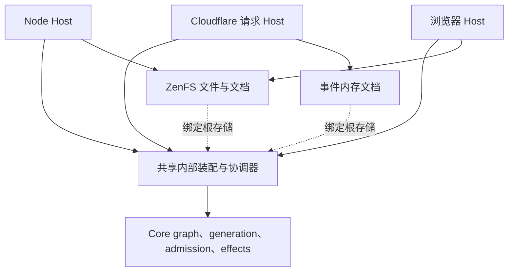

# Pluxel 平台中性运行时提案

> 首条静态插件路径已实现。现有接口见 [Host 配置](../../docs/host/configuration.md#cloudflare-请求-host) 和 [三 Host 示例](../../projects/host-targets/README.md)。下文保留最初的代码依据和后续持久存储、流式接线与服务迁移设计。

Cloudflare Workers 和浏览器适合做第一对目标。Workers 会逼出请求归属、模块求值、回收和持久写入的问题，浏览器会逼出 CORS、CSP、同源存储和多标签页的问题。两端跑通后，静态插件装配、插件调用和基于 Web API 的能力可复用于更多宿主。支持范围按具体能力和真实宿主的验收公布。

**建议为浏览器和普通 Cloudflare Worker 定义各自的 Host 契约，再让同一组静态插件在两个 Host 中运行。** Cloudflare Worker 每次请求创建和结算一个 Host。浏览器由同源 Dedicated Module Worker 持有一个 Host，页面调用它并在重开后恢复本地状态。它们与 Node Host 复用 Core 和内部协调器。ZenFS 保留在需要文件的装配里，配置、运行策略、出站策略和 TinyBase 则从根存储取得文档。

## 重构前的阻塞

| 边界       | 源码事实及影响                                                                                                                                                                                                                                                                                                                                                                                                                                                                                                                                                                                                      |
| ---------- | ------------------------------------------------------------------------------------------------------------------------------------------------------------------------------------------------------------------------------------------------------------------------------------------------------------------------------------------------------------------------------------------------------------------------------------------------------------------------------------------------------------------------------------------------------------------------------------------------------------------- |
| 模块求值   | `@pluxel/host/browser` 已绕过 Node 应用加载器。Core 的 `core-plan` 和 `core-facilities` 仍静态引用 ZenFS。ZenFS 2.8.3 在模块求值时挂载默认 InMemory 根，构造 `StoreFS` 会调用 `crypto.randomUUID()`，固定版 workerd 此时缺少请求熵源。即使到 handler 才动态导入，该模块仍按模块作用域求值。 [Host 入口](../../packages/host/src/browser.ts) · [Core 装配](../../packages/core/src/context/core-plan.ts) · [ZenFS 默认根](https://github.com/zen-fs/core/blob/v2.8.3/src/vfs/shared.ts) · [workerd 熵源](https://github.com/cloudflare/workerd/blob/v1.20261103.1/src/workerd/api/crypto/crypto.c%2B%2B#L1265-L1278) |
| 存储       | `requireHostDocuments()` 转到 `FsService.documents()`，Host 还通过 FS 推断文档 retention。构造 PluginService 时，TinyBase 的生命周期接线会先构造 FsService 和快照目录视图。仅替换 `config.document.storage` 和 `policy.document.storage` 仍会留下出站策略、管理布局和 TinyBase 的 FS 依赖。 [Core 存储](../../packages/core/src/internal/storage.ts) · [Host 文档装配](../../packages/host/src/document-storage.ts) · [TinyBase](../../packages/core/src/tinybase/service.ts)                                                                                                                                       |
| 常驻假设   | Config 文档和 TinyBase 会启动 250 ms 观察。LogTape 安装以 `globalThis` 独占 `configure/reset`，同一 isolate 内并发创建两个启用托管 LogTape 的 Host 会竞争。Host 的 `start()` 当前没有入口 signal，`close()` 要等待已开始的启动。 [文件观察](../../packages/core/src/fs/observe.ts) · [TinyBase writer](../../packages/core/src/tinybase/writer.ts) · [LogTape](../../packages/core/src/logging/logging.ts) · [Host](../../packages/host/src/host.ts)                                                                                                                                                                |
| 出站 HTTP  | `ctx.fetch` 和 `ctx.wretch` 已共享 owner admission、策略快照和原生 Fetch。Core 仍用 `std-env` 判断能否管理代理，并在同一个运行时创建 Undici Dispatcher。Workers 的事件寿命和浏览器的 CORS 都需要在真实传输中验收。 [出站契约](../OUTBOUND_HTTP.md) · [配置判定](../../packages/core/src/http/options.ts) · [运行时](../../packages/core/src/http/runtime.ts)                                                                                                                                                                                                                                                        |
| 安装与交付 | Core pack 内联带补丁的 ZenFS 并按 Node conditions 解析。Commands、Elysia 和 Management 的服务安装入口从 Host 的 Node 根入口值导入 `defineHostService`。`pluxel()` 应用入口只接纳 Node，static bootstrap 使用磁盘路径及 `process.env`。源码按 browser 条件构建成功后，发布制品仍需独立核验。 [Core pack](../../packages/core/tsdown.config.ts) · [Commands](../../packages/services/src/commands.ts) · [应用构建入口](../../packages/rolldown/src/application.ts) · [static bootstrap](../../packages/rolldown/src/cli/static-application.ts)                                                                        |

设计前的浏览器回归已覆盖 Node VM 中运行的 IIFE、Chromium 页面及 classic Blob Worker 中的配置、TinyBase、插件文件恢复和旧句柄行为。固定 `Miniflare 5.20261103.0-beta`、`workerd 1.20261103.1` 和 compatibility date `2026-11-03` 的最小探针复现了静态及动态导入时的顶层 UUID 失败，handler 内 UUID 返回成功。重构后的回归从打包入口在真实 workerd 运行完整请求 Host，示例还从构建输出验证了浏览器 ESM Worker、Node 和本地 workerd 的同一插件链路。 [浏览器回归](../../packages/host/tests/browser/storage.test.ts) · [workerd 回归](../../packages/host/tests/cloudflare/runtime.test.ts) · [三 Host 示例](../../projects/host-targets/README.md)

## 共享运行时与宿主装配

- **Core 保有插件语义。** canonical definition/node address、lowering ABI、依赖 facade、Part 归属、generation 撤回和 effects 清理由现有实现维护。`PluginContext` 继续同步求值，异步资源在 Host prepare 或能力首次使用时取得。 [系统边界](../PLUGIN_SYSTEM.md) · [Core 生命周期](../CORE_LIFECYCLE_SEMANTICS.md)
- **Host 保有装配和就绪判定。** 所有入口调用同一套声明校验、固定服务计划、文档恢复和协调器。同步直接 Core 装配和测试根也复用同一个 Core plan。 [Host 实现](../../packages/host/src/host.ts) · [服务装配](../../packages/host/src/services.ts) · [Core Host 入口](../../packages/core/src/host.ts)
- **环境资源由装配方绑定。** 把文档、文件、日志安装和 Node 代理接到宿主装配边界。Context 内建字段与服务 token 继续承担各自职责。包出口、Core `/internal` barrel 和 pack 产物一起检查，确保共享装配的运行时闭包无需 ZenFS 或 Node 特有模块。以无 Node ambient globals 的 Worker 工程独立检查公共类型，原生 FS 类型从对应文件能力入口验证。 [Core 配置快照](../../packages/core/src/context/core-facilities.ts) · [Core 内部导出](../../packages/core/src/internal.ts) · [Host 包出口](../../packages/host/package.json)

### 各宿主的公开契约

由谁启动 Host、什么输入可以跨调用保留、何时释放资源，共同决定公开入口。相同平台也可以承载不同 Host，例如 Cloudflare 请求 Host 和 Durable Object Host。应用通过导入具体 Host 入口选定这些语义，运行环境名称可用于诊断。 [当前 Host 包出口](../../packages/host/package.json)

| Host                 | 入口                      | 调用方可见的生命周期                                                                                                                     |
| -------------------- | ------------------------- | ---------------------------------------------------------------------------------------------------------------------------------------- |
| Node Host            | `@pluxel/host`            | 应用可用 `defineHostApplication` 和 `runHostApplication` 接入部署输入及源码来源。直接嵌入时用现有 `createHost()`，调用方负责启动和关闭。 |
| 浏览器 Host          | `@pluxel/host/browser`    | 调用方在浏览器中创建、启动和关闭 Host。首个交付路径由 Dedicated Module Worker 持有 Host，页面持有端口。                                  |
| Cloudflare 请求 Host | `@pluxel/host/cloudflare` | 应用在原生 `fetch(request, env, ctx)` 中创建、启动和关闭 Host，并显式提供当次 bindings。流式响应需要应用持有 Host 至响应体结算。         |
| Durable Object Host  | 随共享可写用例确定        | 一个逻辑 Host 归一个 Durable Object，同一对象的请求共享已就绪的 Host。重建从对象存储恢复，每次操作仍有自己的请求和取消边界。             |

应用代码显式选择会产生外部效果的资源，例如 ZenFS 持久挂载、托管 LogTape、代理和 Service Binding。现有 Node 与浏览器入口省略 `zenfs` 时使用 InMemory，声明 `logtape` 才接管 LogTape 安装。新请求 Host 的内存文档保留到当次事件结束。Worker 应用负责为 `ctx.logger` 配置部署日志输出。持久文档和多写者约束由实际选用的存储及其所有者决定。每个入口用自己的配置类型和文档表达这些事实，创建阶段还会校验外部输入。 [日志契约](../LOGGING.md#runtimelogging-lifecycle) · [文件装配](../FS.md#唯一接线与准备)

各个 Host 在内部调用同一装配与协调器。插件作者从 `@pluxel/core` 导入声明 API，应用复用同一组 `plugins` 与可用的 `services`。公共服务安装器从中性的声明叶子取 `defineHostService`，应用用原生 LogTape Config、ZenFS mount 和现有 `coreConfig.http.fetch` 接入能力。服务计划在创建资源前报告缺失的 `requires`、重复 provider 和依赖环。 [插件作者入口](../../packages/core/src/index.ts) · [服务计划](../../packages/host/src/services.ts) · [现有文件后端入口](../../packages/core/src/fs/browser.ts)

公开入口的验收包含一次完整调用。只凭 import、配置类型和最短示例，调用方应能选对 Host，知道数据能否在重开后恢复、何时释放 Host，并能从一次错误配置得到具体修正方向。 [Agent 使用验收](../../.agents/rules/library-api-design.md#agent-使用验收)

## Host 和事件的所有权

### Cloudflare Workers

模块顶层发布静态 imports、已 lowering 的定义和纯数据。入站 handler 从当次 `env` 取得所需输入，在事件内创建 Host、启动预期节点并验收状态，再借出业务实例。首条链路复用 `@pluxel/agent-sdk/host` 的 `createScriptScope({ ctx: host.ctx, signal: request.signal })` 和 `sdk.plugin(Plugin.nodeAddress()).instance()`。业务方法拿到显式 signal，消费响应，返回有界 JSON。返回前依次释放借用和 Host。沿用 Node 的成功判定，预期运行的节点实际达到 running 后才接纳调用。 [Host 启动接纳](../../packages/host/src/application-start.ts) · [进程内 SDK](../../docs/development/scripts.md#在同进程直接使用) · [Workers 请求作用域](https://developers.cloudflare.com/workers/best-practices/workers-best-practices/#do-not-store-request-scoped-state-in-global-scope)

启动和业务调用各有取消路径。把入口信号接入现有 prepare IO 和 `PluginActor.init(signal)` 的控制器，启动预算由宿主声明。取消后撤回接纳，晚到的 init 结果沿原清理路径结算，已经提交的状态仍按提交结果回执。业务方法须把 `request.signal` 传给出站操作，才能让断连撤回它们。Workers 在断连时触发入站 signal 的行为取决于 compatibility date 和 flags。 [PluginActor](../../packages/core/src/plugins/runtime/PluginActor.ts) · [Workers 入站取消](https://developers.cloudflare.com/workers/configuration/compatibility-flags/#enable-requestsignal-for-incoming-requests)

流式 HTTP 的入口要把借用和 Host 的释放交给响应体的 EOF、错误或取消。提前返回 `Response` 时，立即执行 handler 的 `finally` 会撤回仍在使用的 generation。沿用现有 Elysia carrier 的 lease/流清理思路，保留背压，确保只结算一次。有限的尾部工作可用该事件的 `waitUntil()`。需要可靠重试或定时执行时，由部署接入 Queue、Cron 或 Durable Object alarm，每次触发进入同一事件装配。 [现有响应流处理](../../packages/services/src/elysia/ElysiaApplicationDirectory.ts) · [Workers 执行上下文](https://developers.cloudflare.com/workers/runtime-apis/context/#waituntil)

普通 Worker 首期采用事件内存文档、声明式配置、可选的 Vault bindings 和部署日志。可跨事件共享已验证的静态定义和纯装配数据。运行中的 Host、首次 `start()` 的 Promise、请求 Body 和当次绑定的调用结果由原事件持有。并发事件各有自己的出站接纳，限额描述作用域。按实测冷启动、每事件 CPU、内存与响应延迟决定是否提取更多纯计算，沿用已有 definition candidate 缓存。 [定义接纳](../../packages/core/src/plugins/runtime/definition.ts) · [Workers 限额](https://developers.cloudflare.com/workers/platform/limits/)

常驻 Host 的 `LoggerService` 以每根递增的 `root-N` 生成 LogTape 分类。用锁定的 LogTape 2.4.2 做最小探针，128 个弱引用子 logger 回收后，分类树仍留下 128 个 key。现在请求 Host 使用稳定的根分类和静态插件地址，把请求的关联 ID 放进日志属性。常驻 Host 继续由创建它的装配方管理所声明的 LogTape 安装。 [LoggerService](../../packages/core/src/logger/LoggerService.ts) · [分类生成](../../packages/core/src/logger/categories.ts)

### 浏览器

页面创建同源的 ESM Worker，Worker 内创建并启动 Host，通过私有 `MessagePort` 提供已选择的业务操作。消息返回 DTO 或明确可 transfer 的数据。取消消息在 Worker 内连接到本次操作的 `AbortController`，复用相同方法签名。正常关闭由 Worker 停止接纳、等待 `host.close()`、释放存储后回执，页面收到回执后结束 Worker。强制 `terminate()`、崩溃或页面被回收时，以上一次已确认提交为恢复边界。 [HTML Module Worker 与寿命](https://html.spec.whatwg.org/multipage/workers.html#the-worker-s-lifetime)

可写持久 profile 首先使用一个 ZenFS IndexedDB 根挂载。所有写入方按实际数据集的存储身份持有同一个独占 Web Lock，覆盖从打开到关闭的完整 Host 生命周期。另一标签页打开相同数据集时报告占用。缺少所需存储或锁能力则报出具体原因，应用可显式选择会话存储。保存沿用 IndexedDB transaction `complete` 确认。浏览器的存储配额、站点数据清理和持久化权限由应用处理，页面可申请 `navigator.storage.persist()`。正常重开恢复与站点数据被清理后的保留属于不同承诺。 [Web Locks](https://www.w3.org/TR/web-locks/) · [IndexedDB transaction](https://www.w3.org/TR/IndexedDB-3/#transaction-lifecycle) · [Storage Standard](https://storage.spec.whatwg.org/#storagemanager)

## 文档、文件和状态

**保留 ZenFS 的原生文件能力，将文件的选型放回宿主装配。** Node 和浏览器继续使用 `coreConfig.zenfs`、现有 mounts、每根 BoundContext 和 `ctx.fs()`。同一默认桥接沿原路径提供文本后端，因此既有配置、快照、Vault 和插件文件可以直接重开。缺少文件装配的 Host 让 `ctx.fs()` 以已有 `ENOTSUP` 语义拒绝。后续若有 Workers 文件型插件，以真实文件操作、请求寿命和空间上限作为 ZenFS 上游改进的验收。Workers 的 Node 兼容 `/tmp` 是请求内临时空间。 [FS 契约](../FS.md) · [Cache 已有能力判定](https://github.com/PluxelJS/plugins/blob/main/cache/src/index.ts) · [Workers 文件系统](https://developers.cloudflare.com/workers/runtime-apis/nodejs/fs/)

**沿用 `HostDocumentStorage` 做根文档的接线。** 在现有 Core 固定装配中绑定按 namespace 取得文档的工厂，借用者继续使用 `getText/put/stat` 以及后端可选的 `subscribe`。工厂提供实际 retention 与可用字节预算。文件装配把逻辑 namespace 映射到原目录。内存装配在同一根中提交完整值，明确标为 session。Config、state、Logging、出站策略和管理布局各自维护格式、revision 和确认后发布。借用者先撤销观察并结算在途操作，再由创建者释放自有 backend。持久化错误保留原错误和已知提交结果，现有故障恢复仍由各领域决定。让表单配置和快照直接使用原生提交，可省去在 Worker 中为它们实现目录、inode、rename 和文件观察。 [现有文档接口](../../packages/core/src/storage/documents.ts) · [FS 原子提交与关闭](../FS.md#完整提交与发布边界) · [配置](../CONFIG.md)

**TinyBase 继续拥有 native Store 和 writer。** 构造时接入根的快照文档，观察由后端能力启动。Node 文件需要保留外部变更接纳和忙时延后读取的语义。事件内存和 DO 的后端省略观察。沿用 canonical node SHA-256、快照编码、预算、同一根内的单 writer 和故障恢复。写业务在回复前显式等待 `flush()`，同步 Store mutation 仍表示已修改内存。Vault 走现有 `backend: 'bindings'` 与已经校验的 `vaultBindings`，部署将 Worker secrets 转成受节点约束的只读记录。文件型加密 Vault 保有原有 envelope、blob 和锁，浏览器只接收允许页面用户取得的凭据。 [TinyBase 保存语义](../TINYBASE.md) · [Vault 装配](../HOST.md#vault-记录与宿主输入) · [Vault 实现](../../packages/core/src/vault/runtime.ts)

**需要共享可写 Worker Host 时，使用一个 SQLite Durable Object 作为每个逻辑 Host 的写入权威。** 外层 Worker 把该 Host 的受管操作路由到同一对象。对象能保有已就绪的 Host 和纯状态快照，各事件的请求、Fetch 和取消仍留在当次调用。对象回收后从文档重建。对象中的 Host 继续用现有 mutation gate 判定 revision，同一 TinyBase Store 的写入由业务所在的 owner 串行完成 transaction 和 `flush()` 后再确认。独立对象拥有独立数据和运行意图。对象首次恢复可使用短的本地初始化门控，慢出站 IO 留在各调用。 [DO 内存状态](https://developers.cloudflare.com/durable-objects/reference/in-memory-state/) · [DO 生命周期](https://developers.cloudflare.com/durable-objects/concepts/durable-object-lifecycle/#working-without-shutdown-hooks) · [DO 并发规则](https://developers.cloudflare.com/durable-objects/best-practices/rules-of-durable-objects/#use-blockconcurrencywhile-sparingly)

DO 文档的 `put` 需等待 `storage.put()` 和 `storage.sync()` 确认，再发布内存状态。适配器按平台 key 与 value 的组合限制显式收紧文档预算并报告超限。保持现有单文档提交语义，fork 清理等多文档操作继续报告各步实际结果。故障测试要覆盖提交确认丢失与新实例重读。Workers KV 的最终一致性适合读取分发的数据，R2 适合独立对象或大文件，两者均有各自的写入模型。 [DO 持久确认](https://developers.cloudflare.com/durable-objects/api/sqlite-storage-api/#sync) · [DO 字节限制](https://developers.cloudflare.com/durable-objects/platform/limits/#sqlite-backed-durable-objects-general-limits) · [Workers 存储选择](https://developers.cloudflare.com/workers/platform/storage-options/) · [fork 清理](../../packages/host/src/forks.ts)

## 受管出站 HTTP

Core 继续拥有目标 origin 交集、排队后重验、默认 header、超时、按节点记录和 owner 撤回。应用的 `coreConfig.http.fetch` 继续提供最终传输。把代理 URL 对应的 Dispatcher 准备、原生版本适配和资源退役放进 Node 装配。Core 输入校验根据装配可用能力接纳代理配置。保留先准备候选、确认文档、发布同一策略、排空旧连接的顺序，以及已经应用但旧资源清理失败的回执。Web 传输直接传标准 Request，调用方仍收到原生 Response。 [现有提交与传输](../../packages/core/src/http/runtime.ts) · [出站契约](../OUTBOUND_HTTP.md)

- **Workers。** 插件把当前入站请求的 signal 传给出站 Fetch。部署为固定逻辑 origin 接入对应的 `Fetcher` Service Binding，其余允许的目标用平台 Fetch。维持 Request 构造时的原生字段与信号，验收 `cf`、流、断连和 binding 的接收结果。受管 `redirect: 'error'` 沿用 `manual` 单跳后拒绝，调用方显式发出的下一跳仍需应用策略。Cloudflare 的连接限额与框架到响应头的占位各有定义，流式场景以真实连接占用测量为准。 [Workers Request](https://developers.cloudflare.com/workers/runtime-apis/request/) · [Service Bindings](https://developers.cloudflare.com/workers/runtime-apis/bindings/service-bindings/http/) · [Workers 限额](https://developers.cloudflare.com/workers/platform/limits/)
- **浏览器。** 平台决定 CORS、credentials、受限请求头和 `manual` 的 `opaqueredirect` 响应。origin 规则的允许只代表框架已接纳。保留原生网络错误和原生 Response，浏览器端不能从过滤后的响应读取 `Location`。浏览器应用需要访问只允许服务端调用的目标时，由其明确选择自己的同源服务端入口。 [Fetch 标准](https://fetch.spec.whatwg.org/#concept-filtered-response-opaque-redirect)
- **观测。** 记录的范围是产生记录的 Host。普通 Worker 先用 `records: 'off'` 或有界摘要，跨实例查询从部署的日志系统取得。浏览器常驻 Host 可用原有有界日志流。尝试计时到响应头，响应体的 EOF、取消与错误由调用方和 carrier 结算。受管客户端的 origin 规则约束通过 `ctx.fetch` 和 `ctx.wretch` 发出的请求，部署的隔离和出口规则负责其他网络调用。 [日志存储](../LOGGING.md#runtime-store) · [出站归属](../OUTBOUND_HTTP.md#归属与接纳)

## 构建、服务和插件迁移

| 范围                    | 建议的接线                                                                                                                                                                                                                                                                                                                                                                                                                                                                                                                                                                                                                                                                                                                                              |
| ----------------------- | ------------------------------------------------------------------------------------------------------------------------------------------------------------------------------------------------------------------------------------------------------------------------------------------------------------------------------------------------------------------------------------------------------------------------------------------------------------------------------------------------------------------------------------------------------------------------------------------------------------------------------------------------------------------------------------------------------------------------------------------------------- |
| 静态制品                | 复用 Rolldown lowering 和 canonical entry 生成，保持唯一的 Core/Host 以及被选择能力要求的 TinyBase、Cap’n Web 身份。发布两份标准 ESM 入口，由 Wrangler 和浏览器各自装载。实际消费产物检查解析条件、模块闭包、入口与声明。Workers 固定 compatibility date，显式关闭 Node 兼容并检查 Wrangler 最终上传的闭包。应用级 distro 当前声明 Node，有目标交付的真实安装需求后再扩展同一 inventory。 [插件构建](../../packages/rolldown/src/cli/plugin-build.ts) · [发行 schema](../../packages/rolldown/schemas/pluxel-distribution-v1.schema.json) · [Wrangler bundling](https://developers.cloudflare.com/workers/wrangler/bundling/) · [Node 兼容选项](https://developers.cloudflare.com/workers/configuration/compatibility-flags/#nodejs-compatibility-flag) |
| 服务                    | 两个目标从叶子安装。Commands 现有调用路径已接入 owner admission 和 `CommandContext.signal`，适合作为下一项服务验证。Node 的 `servicesPreset()` 在 `workbench: false` 时仍包含 NodeModules 和 Worker Threads。编译、目录发现、源包安装、HMR 和 Node 制品加载继续在现有专用入口完成。 [Commands](../../packages/services/src/commands/service.ts) · [Services preset](../../packages/services/src/preset.ts) · [构建分层](../APPLICATION_BUILD.md)                                                                                                                                                                                                                                                                                                        |
| HTTP 入站               | 首条链路由标准 `fetch(request, env, ctx)` 调用明确选择的插件方法。Elysia 目录已有标准请求分派、租约和响应流清理。后续要验证 generation 路由和 selector 的编译，当前时机可能触发 Elysia JIT 的 `new Function`，Workers 的相关许可只覆盖模块启动。接入前用真实路由验证上游 AOT 或无 JIT 路径，以及 carrier 保留原生请求字段和响应寿命。 [Elysia 目录](../../packages/services/src/elysia/ElysiaApplicationDirectory.ts) · [现有请求适配](../../packages/services/src/elysia/request.ts) · [Elysia Workers 构建](https://next.elysiajs.com/integrations/cloudflare-worker/) · [Workers 启动期 eval](https://developers.cloudflare.com/workers/configuration/compatibility-flags/#enable-eval-during-startup)                                               |
| Management 与 Workbench | 保留插件 publication、鉴权、session epoch 和制品身份。浏览器内嵌可在应用授予的私有 MessagePort 上接 Cap’n Web，会话以显式授权的本地主体开启。Cloudflare 的远程会话要走真实 `WebSocketPair` 升级和资产绑定，分别核验鉴权、101 响应、断连和静态制品授权。当前 Shell 客户端的 WebSocket 与 cookie commit 是独立的承载工作。 [Workbench 架构](../WORKBENCH.md) · [会话客户端](../../packages/services/src/management/web/session/client.ts) · [Workers WebSockets](https://developers.cloudflare.com/workers/runtime-apis/websockets/) · [资产绑定](https://developers.cloudflare.com/workers/static-assets/binding/)                                                                                                                                       |
| 现有插件                | Rates 的 SHA-256 等局部依赖可迁移到 Web Crypto，限流计数仍须明确作用域。Cache 的 `node:v8` 涉及持久字节格式，改编码要做版本化转换。Auth 的密码与凭据契约、Database 的 PgTransaction/advisory lock、Typst 等原生制品各自按能力迁移。D1 作为部署方选择的 SQLite 服务使用。 [Rates](https://github.com/PluxelJS/plugins/blob/main/rates/src/index.ts) · [Cache](https://github.com/PluxelJS/plugins/blob/main/cache/src/index.ts) · [Auth](https://github.com/PluxelJS/plugins/blob/main/auth/src/password.ts) · [Database](../../packages/services/src/database/service.ts) · [Typst](https://github.com/PluxelJS/plugins/blob/main/render/typst/src/index.ts)                                                                                            |

### 本地开发与产物预览

浏览器和 Cloudflare Workers 的生产入口都消费构建时确定的插件集合与版本。应用在目标内装配 Host，运行时仍从本端读取配置、bindings 和数据。Node 上的 Vite+ 负责编辑反馈、lowering 和构建，现有 `@pluxel/host-vite` 的 `pluxel` 环境继续负责本地 Node Host 的 definition replacement 和开发控制台。 [现有 HMR](../HMR.md#canonical-vite-module-graph) · [Node runner](../../packages/host-vite/src/environment.ts)

- **浏览器。** Vite 服务源码，开发页面实际启动同源 Dedicated Module Worker。该 Worker 与生产入口共用 Host 装配，开发更新可先关闭并重建 Worker。这样在编辑时就能检查 Worker globals、IndexedDB 和 Fetch。CORS 用两个真实 origin 的请求验证。Vite 开发时的主配置可作用于 Worker，生产构建要通过 `worker.plugins` 给 Worker bundle 接入同一 lowering，并显式选择 ESM 输出。 [Vite Web Workers](https://vite.dev/guide/features.html#web-workers) · [Vite Worker 构建选项](https://vite.dev/config/worker-options.html)
- **Cloudflare。** 示例用 `@cloudflare/vite-plugin` 在独立的 Vite environment 中通过 Miniflare 启动本地 workerd，在其中运行 Cloudflare 请求 Host。真实部署消费同一个 Host 入口，两端对齐 compatibility date 和 flags，并各自接入 bindings。Vite 负责源码转换与更新调度，现有 `pluxel` environment 则在 Node runner 中运行 Node Host。 [Cloudflare Vite plugin](https://developers.cloudflare.com/workers/vite-plugin/) · [Vite Environments](https://developers.cloudflare.com/workers/vite-plugin/reference/vite-environments/) · [示例的 Vite 装配](../../projects/host-targets/vite.config.ts)

Cloudflare Vite 插件通过 preview 装载构建输出。Dev runner 通过 ModuleRunner 执行转换后的代码，ZenFS 顶层随机数这类涉及 ESM 求值阶段的故障需要用最终模块闭包验证。示例的 smoke test 分别运行制品和开发环境。后续浏览器验收可在构建输出上加 CSP 验证。 [Cloudflare 预览与部署配置](https://developers.cloudflare.com/workers/vite-plugin/reference/migrating-from-wrangler-dev/#input-and-output-worker-config-files) · [示例 smoke test](../../projects/host-targets/scripts/smoke.mjs)

## 交付次序与验收

1. **先交付一个真实的双端闭环。** 从现有 provider/consumer fixture 发展一对正常 lowering 的静态插件。同一节点身份和依赖调用读取应用配置，在 provider 的 Context 发出受管 Fetch，返回小 JSON。用独立安装的 tarball 构建两个目标入口。workerd 走真实 handler 和 Service Binding，浏览器以同源 Module Worker 跑同源及跨源 Fetch，并使用禁用 eval 的 CSP。验证正常响应、策略拒绝、两次并发请求中取消一个时另一个仍成功、启动失败和 provider 退役后的调用拒绝。浏览器另测框架允许但目标服务器未授予 CORS 时的原生失败。用模块闭包和类型检查验证交付物，用现有启动和关闭回归保护 Node 路径。 [已有插件 fixture](../../packages/host/tests/browser/fixtures/runtime/entry.ts) · [隔离与独立安装验证](../TESTING.md)
2. **把状态和流推进到接收端。** 浏览器让同一业务调用更新 TinyBase，确认后重开浏览器 Host，检查配置、Store 与 owner 文件。并行标签页争用同一数据集，模拟配额和写入失败，再读取上次确认的有效内容。Workers 验证慢响应流读完、客户端断连、取消发生在 prepare/init 以及响应头后各自的结算。随后用一个 SQLite DO 运行同一 Host 的共享可写场景，让两次编辑读取同一 revision 后提交，并验证提交故障和新对象恢复。Node 以旧目录和格式重开。 [浏览器恢复测试](../../packages/host/tests/browser/storage.test.ts) · [存储回归入口](../FS.md#实现与验证入口)
3. **明确支持范围后按场景扩展。** 先从 Chromium 验收到已宣布支持的浏览器引擎，Worker 在锁定的本地 workerd 和真实 Cloudflare 部署分别验收。逐个加入 Commands、入站路由和需要的管理会话，每次沿用同一启动与调用链。Worker 首先记录上传体积、模块启动时间、prepare/start 与每事件 CPU、流式并发的资源成本。浏览器记录 Worker ready 时间、IndexedDB reopen 和快照大小。用选定部署的实际预算判断优化，先复用纯的 lowering 和装配计算，再考虑 IndexedDB 整库预载成本是否值得更换后端。 [Cloudflare 本地与生产验证](https://developers.cloudflare.com/workers/local-development/) · [ZenFS DOM 后端](https://zenfs.dev/dom/)

评审时优先确认两项决策。第一是普通 Worker 按事件持有 Host，跨事件的共享可写状态归 SQLite DO。第二是抽出根文档装配并保留 ZenFS 文件能力。它们共同决定首个改动的位置和验收条件，后续插件、Workbench 和动态来源可以沿实际用例推进。
