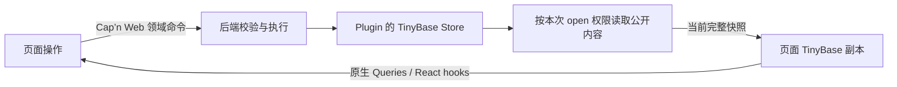

# 插件临时状态内置 TinyBase，SQL 数据库外置

状态：提案，尚未实现。日期：2026-10-30。源码审查基线：Pluxel `5161c680`。

**Pluxel 内置的常用数据能力改为 TinyBase 临时状态；PGlite／PostgreSQL 及其数据库管理和构建工具整体外置，按需安装。** 页面通过领域命令请求修改，后端校验并写入，再把授权数据同步给页面。

这里的“外置”是依赖、发布和装配边界，不要求数据库一定在另一台机器。这里的“临时”是 Plugin generation 内的内存状态，不承诺重启恢复。本次只形成设计和迁移提案，不修改当前运行时、依赖或已有数据。

配套的 [Worksplit API 精进提案](https://github.com/PluxelJS/split-like-vscode/blob/bd6ddfa3e5a9c866a412597e9001b530526e4250/refactor/API_REFINEMENT_PROPOSAL.md) 负责页面资源接入；两者通过资源所有权组合，Worksplit 不依赖 TinyBase 或 Cap’n Web。

## 1. 当前事实与目标差异

当前 [Database](../DATABASE.md) 已经是显式安装的可选 capability，但运行实现仍在 `@pluxel/services`，schema artifact、Vite 转换和数据库 CLI 分散在框架工具链中。单纯把 driver 标为 optional 不等于完成外置。

当前 Workbench 使用 [TanStack Query 与领域订阅](../../docs/workbench/renderer-resources.md)，主要是查询 DTO、失效通知和重新读取，没有通用表副本协议。现有数据库 schema 使用普通 Drizzle `pgTable()`；要移出的自有部分是 owner、迁移声明、artifact 和运行管理，不把 Drizzle 误称为自造 schema。

| 用途                                             | 目标所有者与默认路径                                  |
| ------------------------------------------------ | ----------------------------------------------------- |
| 任务进度、运行结果摘要、可重建索引、插件会话状态 | 内置 TinyBase，随插件本代运行结束                     |
| 页面读取、关联查询、按行或单元格刷新             | 授权后的前端 TinyBase 副本及原生 Queries、React hooks |
| 业务写入、权限判断、外部副作用                   | 后端领域命令，经现有 Cap’n Web capability 调用        |
| 必须保存的业务记录、SQL、约束、迁移和备份        | 独立 SQL 包，由应用显式安装和配置                     |
| 配置、密钥、日志、文件和必须恢复的编辑草稿       | 保留各自已有能力；不为了统一存储搬入临时 State        |

采用 TinyBase 的理由是复用状态模型、事务通知、查询和 UI 订阅，减少自有状态基础设施。其 [TinyQL](https://tinybase.org/guides/using-queries/an-intro-to-queries/) 是类 SQL 的 JavaScript 查询接口，不是现有 PostgreSQL SQL 的执行替代品；[Persister](https://tinybase.org/guides/the-basics/architectural-options/) 也不自动赋予内存 Store 数据库级持久性。

## 2. 内置 State：原生 Store，明确寿命

### 2.1 一个取得入口

建议新增 `@pluxel/services/state`，由 `standardServices()` 安装，`servicesPreset()` 随之获得。自定义 Host 组合显式安装同一 `state()` descriptor。Core／Context kernel 不依赖 TinyBase；没有取得 State 的 Plugin 不创建 Store，也不创建任何持久化、定时器或网络资源。

Plugin 通过 `ctx.require(State)` 取得本 generation 的原生 TinyBase `Store`。不同时增加 `ctx.state`、`defineState()`、命名 Store registry 或另一套 CRUD／query wrapper。State token 只负责创建与所有权，数据操作、schema、查询和监听直接使用 TinyBase API。

以下为拟议入口的业务片段，尚不可导入；`input` 已通过领域命令校验：

```ts
import { State } from '@pluxel/services/state'

// Plugin init：同一 generation 重复 require 返回同一个 Store。
const store = ctx.require(State)
store.setTablesSchema({
	tasks: {
		title: { type: 'string' },
		status: { type: 'string' },
	},
})

// 后端命令完成输入、权限与业务检查后，提交同步的状态变更。
store.transaction(() => {
	store.setRow('tasks', input.id, { title: input.title, status: 'queued' })
})
```

Store 为 owning Plugin generation 私有；Part 使用同一个 owning generation 的状态，不另开数据库或隐藏状态层。Plugin、fork 和新旧 generation 不共享 Store；跨 Plugin 使用明确的领域方法，不提供任意按 plugin id 取 Store 的全局入口。

异步 IO 在 TinyBase transaction 外完成，提交前重新确认调用所属 generation 仍有效。TinyBase transaction 只表达本地状态变更，不承诺与远端服务、文件或 SQL 原子提交。

### 2.2 “临时”必须可预测

| 事件                                                              | 状态行为                                       |
| ----------------------------------------------------------------- | ---------------------------------------------- |
| 页面刷新、tab 关闭后重开                                          | 后端 generation 仍存续时，重新读取它的当前状态 |
| 所有页面都关闭                                                    | 只释放页面订阅；后端状态继续属于 Plugin        |
| Plugin stop／restart／replacement，包括发生 generation 更替的 HMR | 结束旧代状态与发布；新代从空 Store 初始化      |
| 进程重启或崩溃                                                    | 状态丢失；需要恢复的数据使用外部持久能力       |
| 无 Workbench 的 Host                                              | State 照常工作，零浏览器同步资源               |

默认不安装 Persister、不自动保存文件、不创建 IndexedDB 缓存，也不在 HMR 时偷偷拷贝旧状态。插件拥有必要的重建逻辑。将临时数据改为持久数据是业务契约变化，不能用一个 `persist: true` 选项隐藏迁移、恢复和提交语义。

停止沿现有 generation admission／effects 顺序进行：关闭新操作和发布资格，处理已接纳工作，释放框架创建的监听与页面连接，最后释放旧 Store 引用。Plugin 自己创建的原生 listeners、Queries 等资源通过已有 effects 清理，不再造一个生命周期系统。

原生 Store 是本地可变对象，不伪称拥有每次方法调用的撤权代理。旧引用只能指向旧代内存，不能重绑新代、继续对外发布或取得新权限；框架跨边界的命令与订阅仍必须拒绝失效 owner。异步晚到工作不得借重新 `require` 把旧结果写入新代。

### 2.3 Schema 只定义必要事实

基础字段直接用 TinyBase schema；需要复用既有 Valibot 定义时使用官方 [Schematizer](https://tinybase.org/guides/schemas/using-schematizers/)。不增加 Pluxel schema DSL、codegen 或通用字段映射器。

Schematizer 是尽力转换，不保证保留任意 refinement、transform 或嵌套约束。命令入口继续执行原始 validator 与业务校验。TinyBase schema 可能忽略无效字段或补默认值，见 [schema 行为](https://tinybase.org/guides/schemas/using-schemas/)；不能以 Store 接受了数据作为命令输入合法的证明。

后端私有状态按原生 TinyBase 能力使用；跨浏览器的数据必须同时满足现有 Workbench portable-data 契约。只校验实际公开的内容，不为前端限制所有后端私有值。原生 schema-aware 类型推导需在接入验证中确认，不以自造泛型系统补齐未经验证的类型承诺。

## 3. Workbench：后端权威的一条状态接入路径



采用普通 `Store`，第一版不使用 `MergeableStore`／WebSocket Synchronizer。官方同步解决 [LWW 多副本合并](https://tinybase.org/guides/synchronization/using-a-mergeablestore/)，不直接提供本提案的命令写入边界；[WsServer](https://tinybase.org/api/synchronizer-ws-server/functions/creation/createwsserver/) 也不负责路径授权。现有 Cap’n Web session 已承载命令、身份和资源归属，继续复用，不新开第二套同步连接。

### 3.1 框架接管重复的接线，作者保留领域判断

建议为 Workbench 增加一对有独立职责的入口：服务端 `createWorkbenchState()` 把本地 Store 的授权读投影接到当前 open；renderer 的 `scope.state()` 声明该页面的状态资源。它们不包装 TinyBase 的数据操作，只管理首次加载、订阅、失败和释放。

下面是拟议调用形状，不是已实现签名。`readVisibleState` 返回原生 TinyBase `Content` 形状 `[tables, values]`；权限检查来自本次 open，禁止默认导出整个私有 Store。

```ts
// 本次 open 的 RpcTarget 方法；框架 helper 创建独立的只读状态 capability。
openState() {
	return createWorkbenchState({
		store: this.store,
		signal: this.signal,
		read: () => this.readVisibleState(this.principal),
	})
}

// renderer module：scope 沿用现有 createWorkbenchRenderer() 的返回值。
const tasksState = scope.state(({ api }) => api.openState())
```

组件通过 `tasksState.useState()` 取得可区分的 `pending`／`ready`／`error` 结果；`ready` 才提供原生 Store，交给当前 renderer 内的 TinyBase Provider、Queries 和 hooks。首次加载失败不能伪装成“空列表”；更新失败允许保留上次数据，但须明确标记失效与错误。具体类型在首个真实消费者中确认，不为所有远程资源预建万能 Resource 抽象。

数据只通过这条路径同步，不再为同一份状态声明 queryKey、watch、invalidate 和第二份 Query cache。既有 query／mutation 仍适用于一次性远端请求、分页数据库查询与领域命令；它们不是临时 Store 的另一种推荐接法。

后端只开放读取／订阅 capability，没有通用 `setCell`／`applyChanges` RPC。页面业务写入调用命名命令，校验完成才修改后端。原生前端 Store 即使被本地代码改动，也没有上传通道；readonly 类型不承担权限保证。筛选、选择、输入中的草稿使用页面本地状态，不写进后端投影副本。

### 3.2 第一版只同步有界的最新快照

面向临时小数据集，先采用完整授权快照，不立即设计增量 patch、日志游标、离线重放或冲突合并。后端监听 TinyBase transaction 完成，合并连续更新，只保留一个在途发送和一个待发送最新状态；无需持久 outbox。

框架在服务端先挂监听再读取初始内容。`read` 是同步、无副作用的投影函数；读取后生成独立 portable 快照，不能在异步发送期间借用仍会变化的 Store 对象。初始结果和后续消息在同一订阅中排序，防止旧初始结果覆盖新状态；序号仅属于这次连接，不成为业务 revision 或持久恢复日志。

浏览器完成数据校验后使用原生 [`setContent()`](https://tinybase.org/api/store/interfaces/store/store/methods/setter/setcontent/) 更新副本，删除也由完整内容替换表达，不发明缺失字段或 tombstone 协议。复用现有 portable 预算；快照超限必须明确失败，不能截断为“成功”。第一版以实际示例确认快照大小、更新时间与内存成本，不声称适用于大表或高频流。

断线后旧副本明确失效；现有会话恢复并重新 open 后加载当前完整状态，不上传浏览器旧值。断线期间不排队业务写入，也不自动重试可能产生副作用的命令。订阅传递的是最新状态，可能合并中间变化；日志、审计、逐事件进度和可靠任务回执继续使用相应领域协议。

权限在服务端 open／投影边界执行。principal、权限或 Plugin generation 失效时撤回旧 open，不把未授权行发给浏览器后再筛选；旧消息不得写入新 owner 的 Store。

### 3.3 页面寿命与 Worksplit 的组合

后端 Store 归 Plugin generation；状态 target、浏览器副本和订阅归本次 renderer owner。两个 tab 可以观察同一后端，仍各自拥有授权副本；关闭一个不能清空后端或关闭另一个。

Worksplit 提案中的 `useWorkbenchContent()`／`content.effect()` 由 Shell／Bridge 用来绑定 renderer 资源。普通业务组件使用 `scope.state()` 后，不再手动把同一订阅登记到 Worksplit。关闭被拒绝时连接继续；正式关闭、撤回或卸载时停止发布，释放订阅和 stub；晚到获取结果立即清理。

不把 TinyBase React Context 放进 Shell 私有 Provider，再要求远端跨 React root 读取。Provider 与 hooks 留在同一 renderer；跨边界只传 DTO／capability。TinyBase 不因这次接入自动成为 MF 全局 singleton；依赖版本和 Store 结构互操作由安装后的真实消费者验证。

## 4. SQL 外置：移动完整职责，不只移动 driver

建议独立发布 `@pluxel/database`。它可以继续在本 monorepo 开发，但必须单独安装；Services、标准 preset、Workbench 和默认工具链不能反向依赖它。原来的 SQL 能力与临时 State 表达不同的数据寿命，不做一个带 `backend: 'tinybase' | 'postgres'` 的通用存储接口。

| 当前职责                                                                                        | 目标归属                                             |
| ----------------------------------------------------------------------------------------------- | ---------------------------------------------------- |
| `packages/services/src/database.ts` 与 `src/database/` 的 token、handle、driver、迁移和运行管理 | 外部 SQL 包；保留必要的 owner／drain／数据完整性语义 |
| `@pluxel/services/database`、`/database/pglite`、`/database/postgres`                           | 迁移为独立包对应入口，删除旧 exports 和转发 alias    |
| `packages/rolldown/src/database/`、`src/vite/database-source.ts` 的数据库专用处理               | 外部包的构建集成，由 SQL 消费者显式选择              |
| `packages/cli/src/commands/database.ts`、数据库 capability loader 和命令定义                    | 独立包自己的 CLI；默认 `pluxel` 不再内置数据库命令   |
| 标准 Vite／build 装配中的数据库自动发现与 artifact 注入                                         | 删除默认接线；需要 SQL 的应用显式接入外部包构建入口  |
| SQL 专属依赖、测试、文档与发布入口                                                              | 随独立包迁移；基础插件的安装／构建不加载数据库栈     |

外置第一步保留现有 SQL 数据与所需契约，不顺手改变 physical schema、lineage、role、migration history 或 outbox 语义。暂时仍需要的 outbox 成为外部包内部职责，不是 TinyBase 同步依赖。迁移 import 路径和迁移数据库内容是两种操作，不能因为包改名就重建数据。

独立包直接提供原生 Vite／构建集成与 CLI，不为外置一个功能新增通用 compiler plugin registry。默认框架中的 SQL 专用扫描、转换和依赖应真正移走；独立安装后验证生产构建与开发转换使用同一份 SQL artifact。

当前对 `plugins/` 与 `projects/` 的源码搜索未发现实际使用 `defineDatabase()` 的业务调用方，主要消费在框架测试、文档和工具链；这不是“没有已有数据”的证明。实施前仍需核对实际安装入口和持久目录。不得把原 SQL 内容自动迁到临时 State；确需转换时按数据用途显式执行一次性转换，验证后删除转换代码。

只在真实依赖仍存在时保留相应 SQL 功能；评估移除外部包内的旧 trigger／outbox 时，另行确认使用方和已有数据，不作为这次内置 State 的前置条件。

## 5. 迁移顺序与删除清单

1. **证明最短完整路径。** 选一个真实临时状态页面：后端 Store、授权命令、两个 tab、首次读取与更新、关闭和 generation 更替。使用真实 Cap’n Web 与打包后的 renderer，不用纯内存 mock 代替边界验证。
2. **完成 State 与 Workbench 接入。** 固定上述原生调用形状和生命周期，迁移该用途的全部已知消费者，删除被取代的 DTO 拼装、重复 watch／invalidate、缓存与手写资源登记。不改动仍服务其他用途的 query／mutation。
3. **完成 SQL 整体外置。** 同一交付批次迁移 runtime、工具链、CLI、测试、文档与依赖，删除旧 Services exports、默认 SQL 构建接线和兼容入口；不提交一个本体仍隐式依赖外部包的中间完成态。
4. **同步两份提案的所有权边界。** Worksplit 新 API 落地时删除旧 lifecycle／register 路径；State 接入只保留 renderer owner 到 content effect 的一处资源登记，不叠加旧 Pluxel resource Set。

这些是实施次序，不是长期共存的两套默认入口。相关功能批次必须可完整交付，必要的公开 breaking change 在实施时记录 Tegami；本次纯提案不创建空 changelog。

正式文档分别更新 `engineering/DATABASE.md`、State 所属工程入口、Host 装配、插件状态用法、Workbench renderer resources、CLI／模板和包 exports。当前文档在实现前继续描述当前契约，不提前展示拟议 API 为可用能力。

## 6. 验收与尚未验证的边界

| 验收目标           | 必须观察到的结果                                                                                      |
| ------------------ | ----------------------------------------------------------------------------------------------------- |
| 默认轻量接入       | 不安装 SQL 包也能创建、构建和运行使用 State 的插件；未取得 State 时无 Store、数据库 driver 或同步资源 |
| 状态寿命           | 刷新／关 tab 不清空后端；Plugin 新代与进程重启从空状态开始；旧代晚到结果不污染新代                    |
| 写入与权限         | 无效／无权命令不修改后端；直接修改前端副本不能写回；授权外的数据没有出现在网络负载中                  |
| 初始读取与连续更新 | 注册和首读之间的变化不丢；旧结果不覆盖新结果；删除、空表、批量更新与两 tab 一致                       |
| 失败与边界         | 加载失败不是空数据；超限明确失败；断线标记失效，恢复重新取得权威快照                                  |
| 资源释放           | 拒绝关闭保持订阅；成功关闭只释放本次 owner；StrictMode、晚到获取、Plugin 撤回均无遗留                 |
| 原生互操作         | TinyBase 查询、schema-aware 类型、Provider 与 hooks 能从发布入口使用；不依赖 Shell 私有 Context       |
| SQL 独立交付       | 独立包安装、开发、生产构建及已有数据库重新打开成功；基础包不再包含旧 SQL 入口和自动接线               |
| SQL 行为保留       | PGlite 验证本地语义；PostgreSQL 验证池、锁、跨进程迁移等实际保留的契约，不互相替代证据                |
| 减少维护成本       | 一个页面只声明一次状态资源并使用原生 hooks；不需要逐页实现快照／订阅顺序、重连恢复或释放协议          |

本轮已核对现有源码入口、公开文档及 TinyBase 官方能力，未安装 TinyBase、未运行新的同步链路、未迁移数据库。完整快照的成本、schema 类型推导、外部 SQL 构建接入以及实际持久数据清单由实施首轮验证；发现问题先收窄或修正对应边界，不自动升级成 CRDT、通用 ORM 或新的资源框架。

默认范围保持为单宿主进程内、Plugin generation 拥有的临时状态。离线写入、多进程共享状态、持久草稿、自动故障接管、大表复制和 SQL → TinyBase 自动镜像不在本提案内。
