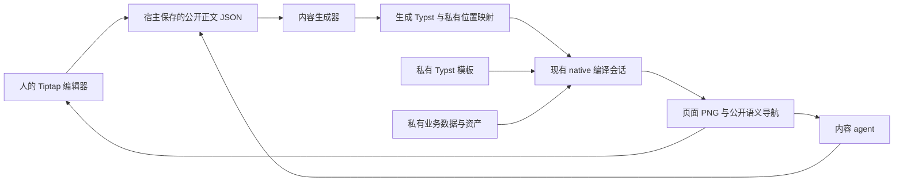

# Typst 内容创作与私有排版边界重构提案

状态：待采纳、未实施。2026-11-04。

本文是一次不保留兼容层的重构设计，不是当前 API 文档。当前实现仍以包 exports、[Typst DESIGN](../../plugins/render/typst/DESIGN.md) 和实际调用方为准。

已确认的产品边界：**外部编辑者可以查看最终页面，但不能取得原始业务数据、模板代码和资产文件。** 本轮交付提案，不修改运行中的编辑器。

## 1. 核心决定

让外部编辑者直接拥有并编辑公开正文，私有模板只负责把正文排成最终页面。

目前“所有正文都必须以 `.typ` 为权威，再投影成可编辑 JSON”的约束需要收窄。它适用于源码创作，却给只需要 Typst 排版的应用引入了不必要的双向转换。

重构后保留两个独立能力：

- **源码创作**：`.typ` 是权威输入，富文本编辑器是它的结构化编辑视图；允许访问源码的人和 agent 直接使用源码工程。
- **内容创作**：Tiptap JSON 是权威正文，服务端单向生成 Typst，再与私有模板、业务数据和资产一起排版。

这不是项目级的 `mode: source | restricted`。同一份成品完全可以由内部人员维护 `.typ` 模板、外部人员维护 JSON 章节、业务系统提供数据。它们拥有不同的事实；**同一段正文不能同时由 JSON 和手写 `.typ` 负责。**

下游通过导入能力、装配视图和提供接口决定使用方式。核心不认识用户角色，不管理 agent，不引入一套 `canReadSource/canEditLayout/canMoveBlock` 权限配置。

代价也要明确：JSON 正文生成的 `.typ` 是可丢弃的编译产物，不能再作为第二个可编辑正文。若业务决定把某份正文改为源码创作，执行一次显式转换并更换权威来源，不提供长期双向同步。

## 2. 当前实现说明了什么

以下结论来自源码与调用方核对，未通过本轮新的运行时实验验证。

| 当前事实                                                                                                               | 证据                                                                                                                                                                          | 设计判断                                                     |
| ---------------------------------------------------------------------------------------------------------------------- | ----------------------------------------------------------------------------------------------------------------------------------------------------------------------------- | ------------------------------------------------------------ |
| `createTypstDocumentProject` 从私有 SourceProject 解析正文，隐藏 import、路径、标签和未知源码；提交时再还原            | [document/project.ts](../../plugins/render/typst/src/document/project.ts)                                                                                                     | 删除这条私有源码与公开正文之间的往返链路                     |
| 隐藏块依赖实例内 HMAC/随机引用 ID，编辑校验还要求占位块序列不变                                                        | [document/project.ts](../../plugins/render/typst/src/document/project.ts)、[document-content.ts](../../plugins/render/typst/src/tiptap/document-content.ts)                   | 不把“未知源码”“固定布局”“业务组件”继续归为一种不可移动占位块 |
| 文档编辑器已经接受 `JSONContent`，底层工厂支持原生 extensions，但 React 包装仍绑定固定占位和 `documentReferences` 分支 | [document-editor.ts](../../plugins/render/typst/src/tiptap/document-editor.ts)、[document-editor-react.tsx](../../plugins/render/typst/src/tiptap/document-editor-react.tsx)  | 保留编辑能力，移除源码投影约束，补足实际需要的组合入口       |
| native 已能从同一次编译取得 PNG、真实字形位置、标签目标和内部链接                                                      | [native/README.md](../../plugins/render/typst/native/README.md)                                                                                                               | 复用现有编译与定位能力，不重建分页器或从 SVG 猜位置          |
| 第三个演示直接提供 `/document-api/asset/architecture` 原始 SVG，并直接调用 native PDF 导出                             | [consumer/server.ts](../../plugins/render/typst/tests/consumer/server.ts)、[document-private/server.ts](../../plugins/render/typst/tests/consumer/document-private/server.ts) | 当前演示尚不满足此次明确的“拿不到原始资产文件”边界           |
| Studio、源码演示和 agent workspace 都有真实源码工程用法                                                                | [SourceProject](../../plugins/render/typst/src/source/state-types.ts)、[agent workspace](../../projects/typst-agent-workspace/README.md)                                      | 保留源码能力，不强迫这些消费者改存 JSON                      |

其中 `writablePaths` 是写入范围。它不使同一编译根里的其他文件变成不可读，也不等价于外部编辑者的隔离边界。

## 3. 名称与事实的所有者

| 概念     | 含义与所有者                                                   | 编辑行为                                                |
| -------- | -------------------------------------------------------------- | ------------------------------------------------------- |
| 排版模板 | 宿主维护的 `.typ`，决定页面、固定表格骨架、页眉页脚、徽标等    | 模板开发者编辑；不作为正文块出现                        |
| 正文单元 | 一章、一节或一个可独立提交的富文本区域；宿主持久化 Tiptap JSON | 使用普通 Tiptap 编辑、重排和跨单元引用                  |
| 插入预设 | 一组普通正文节点的创建快捷方式                                 | 插入后就是普通内容，不保留额外模板身份                  |
| 业务组件 | 宿主定义的语义节点，如“经营图表”或“项目摘要”                   | 用原生 Tiptap NodeView 编辑公开参数，服务端执行可信渲染 |
| 业务字段 | 姓名、申请类型、预算等有业务含义的数据                         | 由业务接口拥有；是否提供编辑器由宿主决定                |
| 渲染产物 | 生成的 Typst、布局、页面、导航数据                             | 可重建；不反向成为正文或业务字段的权威                  |

“模板块”不再作为统称。原先讨论的固定区域属于排版模板；能插入后自由修改的样板叫插入预设；具有独立交互和渲染逻辑的对象叫业务组件。

库不负责保存业务字段的第二份值。字段引用保存公开字段 ID，服务端把它解析为当前值；生成的 `#let`、Typst 字典或者 `/inputs/*.json` 都只是传值方式。引用字段不自动授予字段读取接口或编辑接口。

## 4. 唯一的内容排版链路



源码创作独立使用现有 `SourceProject → 源码编辑器 → 编译会话`。两种创作能力共享编译器、可复用的富文本工具及页面交互，不共享“隐藏源码”的状态机。

内容链路的服务端控制流保持直接：读取一次一致的正文和私有输入快照，校验正文，生成临时文件，编译，发布与本次编译绑定的页面及导航。保存正文成功与排版成功是两个事实；排版失败不能假装保存失败，也不能把旧页面标为新版本。

### 4.1 新增能力：无状态内容生成器

拟新增 `/content` 入口，提供 `emitTypstContent` 以及组合 native 导航所需的内容位置映射能力。名称和下列类型是提案，不是可运行的现有 API。

```ts
const generated = emitTypstContent({
	documents: [{ id: 'reason', document: reasonJson }],
	schema, // 由实际使用的 Tiptap extensions 得到的原生 schema
	renderers, // 与此 schema 对应的可信节点/mark 生成器
})

// generated.files: 受控相对路径 -> 生成的 Typst 文件
// generated.entries: 正文单元 ID -> 对应生成文件
// generated.mapping: 源码范围 -> 正文单元与当前 JSON 位置
```

普通用法使用库提供的同一套默认正文扩展与生成器。自定义节点才需要补生成规则；不要求普通段落、列表、表格使用者逐个注册。

生成器只拥有 JSON 校验、受控 Typst 生成和来源映射。它不创建 SourceProject，不保存历史，不访问 HTTP，不管理用户权限，也不持有长生命周期编译会话。

生成器本身不绑定部署位置：输入全部公开时，下游可以选择本地或浏览器排版；本提案的私有模板场景把生成、资源解析和编译装配放在服务端。这个选择由调用方完成，不通过核心模式开关改变语义。

严格检查节点、marks、属性值和内容结构。服务器不能依赖浏览器已经过滤过输入，也不能把未知节点静默丢掉后返回成功。schema 中的自定义节点没有生成器时，返回具体节点位置和不支持原因。

不能直接公开当前 `serializeNode` 作为这项能力：它服务于源码回写，包含原始 Typst、import/include 和源码属性语义。可以复用经过审查的纯文本编码、表格等实现，但两条链路各自拥有明确的输入契约。

### 4.2 生成文件与模板组合

正文生成到私有构建目录中的 `_content/<受控 ID>.typ`。模板使用普通 Typst `include` 或宿主生成的章节入口组合它们；外部编辑者只见章节标题、顺序和公开 ID。

不把这些正文源文件放进 `/inputs/`：现有 native 导航会排除该目录。业务 JSON 仍可走现有 `/inputs/` 数据通道。

模板如何排正文，由正常的 Typst 函数调用和内容参数表达。无需恢复一个全局 region/slot 注册系统，也不需要运行时扫描私有模板寻找可编辑区域。

这里选择“生成源码并保留映射”，不同时维护“让 Typst 解释整份 Tiptap JSON”的第二条生产链路。后者容易把多个段落的来源集中到同一个解释函数，增加精确导航的难度。

### 4.3 状态与生命周期

宿主拥有正文存储、业务数据、访问控制、提交事务和持久化历史。库拥有编辑器、生成器和现有编译会话各自的契约。

生成文件与映射是一次输入快照的派生值。宿主保持它们与 retained native document 同寿命，使用现有会话释放机制回收；不新增一个重复管理编译、缓存和任务的 ContentProject 引擎。

## 5. 自定义组件、字段与固定区域

普通表格仍是 Tiptap table 节点。只有有业务规则的交互，才需要业务组件。无需把所有 UI 都包装成自定义组件。

一个经营图表节点可以只保存公开的对象 ID 和允许编辑的标题，例如：

```json
{
	"type": "businessChart",
	"attrs": { "id": "chart-quarterly", "caption": "本季度经营情况" }
}
```

宿主安装三项实际需要的实现：原生 Tiptap 节点及属性校验、前端 NodeView、服务端生成器。生成器通过宿主提供的可信对象绑定读取私有数据；JSON 不包含数据路径、资产路径、JSONPath、模板函数名或用户传入的 Typst 表达式。

对象绑定只接受本次文档明确提供的公开对象 ID；任意猜测一个 ID 不能读取其他文档的数据。引用目录和业务对象访问由宿主已有业务边界检查，不由核心发明一套新的授权协议。

这些实现可以组织在同一个下游组件包里，但客户端入口只能包含公开 schema 和 UI；私有生成器、数据和模板不能进入浏览器 bundle。核心无需再发明跨运行时组件插件系统。

NodeView 可以展示参数控件、占位内容或允许公开的栅格化效果。不能为了让编辑器显示徽标，就直接提供原始 SVG 文件。

普通业务组件默认可以作为正文移动、复制或删除。若某个审批结论必须固定存在，优先把它放到私有模板或独立业务区域。确有“正文中的固定对象”需求时，由该节点的扩展和宿主提交校验共同表达该业务约束；核心不根据节点未知、私有或不可编辑推导“必须固定”。

字段编辑也是组合问题：提供某字段的表单与 setter，用户就能编辑；只提供正文中的字段引用，用户就只能插入引用。没有编辑需求时，不要求开发者额外写“禁止编辑”代码。已有业务表单可以直接复用，不为所有字段生成一个通用权限面板。

## 6. 保护的是输入与执行环境

浏览器和内容 agent 取得：公开正文、必要的公开引用目录、宿主明确公开的组件参数、最终页面及其语义导航。它们不取得：模板源码、原始数据集、原始资产、私有文件清单、原始 source map 或私有编译诊断。

**最终页面中出现的文字、数值和图形外观已经公开。** 本设计不承诺阻止截图、OCR、重新描绘图标或从已展示数字进行推导，也不能把一个页面上显示的值继续称为保密值。

### 6.1 任意源码不能进入私有排版环境

只在 UI 隐藏 `.typ` 不构成边界。若外部提交的任意 Typst 与私有输入一起执行，它可能通过读文件或排版把私有输入带到最终页面。

因此，内容入口只接受经过校验的正文和公开参数。字符串按数据编码；路径、label、尺寸和颜色等分别使用受控生成规则。禁止把文本、组件属性、公式或链接直接拼进可执行源码。仅转义一个总字符串不足以覆盖所有输入通道。

可以给可信源码作者完整 Typst 工程。若某个外部作者可以编辑 Typst，却仍不能接触私有资产，则他的源码只能在不含这些私有输入的独立编译环境中执行，最终产物再交给宿主组合；不能靠 `writablePaths` 实现。Typst 的文件访问以编译根为边界，具体运行环境还需以本地绑定验证。[Typst 文件路径文档](https://typst.app/docs/reference/foundations/path/)

### 6.2 公式必须单独处理已发现的执行路径

当前固定的 MiTeX 资源含 `eval`：不仅转换结果会被求值，部分间距/偏移命令也对参数求值。可在 [mitex-files.json](../../plugins/render/typst/src/tiptap/mitex-files.json) 核对。这证明存在需要审查的执行路径，**不等于本轮已经证明了可利用漏洞**。Typst 官方也明确 `eval` 会求值源码字符串。[Typst eval 文档](https://typst.app/docs/reference/foundations/eval/)

本方案不把外部 LaTeX 直接交给能读私有文件的 MiTeX 环境。选定的最小隔离路线是：在仅含公开公式、必要的公开数学资源与字体的编译环境中生成公式图像和尺寸/基线，再由私有模板组合该产物。沿用现有编译能力，不要求另部署一套网络服务。

首次实现采用栅格公式产物；公式内容仍以原生数学节点保存并可编辑，预览定位到公式节点。代价是放大精度，需要验证行内基线与目标输出清晰度。若之后要换成向量产物，应在隔离环境边界验证其引用与元数据，而不是重新把不受约束的求值放回私有编译环境。

这项隔离只用于接受外部公式的内容装配。可信源码创作保留既有公式能力。

### 6.3 页面、下载与错误的出口

公开预览使用 native 渲染的页面 PNG，加上必要的语义导航。PNG 只由已渲染像素重新编码，不夹带源码、原始资产或私有元数据。

第三演示的原始 SVG 路由应删除。私有组件在编辑器中的效果改用公开页面片段或服务端重新生成的栅格图；改一个不透明 URL 名称不能保护原文件。

原生 PDF/SVG 导出也不能直接满足相同边界：PDF 可能嵌入原始图像，SVG 会暴露矢量路径，附件和元数据还可携带额外信息。本地 native 锁定的 Typst 0.14.2 PDF 图像实现存在直接使用 JPEG 字节的路径。[Typst 0.14.2 图像导出实现](https://github.com/typst/typst/blob/v0.14.2/crates/typst-pdf/src/image.rs)、[Typst PDF 附件](https://typst.app/docs/reference/pdf/attach/)

第三演示若保留下载按钮，出口改为**仅由公开页面栅格图组成的 PDF**，仅加入允许公开的元数据；不把原生 PDF 清理几个字段后直接发布。代价包括文本选择、搜索、无障碍结构和放大质量。本次提案选择满足已确认的输入保护边界；原生矢量 PDF 导出仍保留给有权取得它的源码/内部应用。

用户正文错误返回公开节点位置和可理解原因；私有模板错误返回稳定错误码与诊断编号，详细源码诊断留在服务端。公开链接也由宿主判断目标 URL 是否允许发布，不能仅检查 scheme 就把包含私有路径或参数的链接送出去。

## 7. 预览互动仍由真实编译结果驱动

新的映射链为：

`公开 JSON 位置 → 生成 Typst 源码范围 → native 编译几何 → 公开 JSON 位置与页面坐标`。

源码范围和私有路径只留服务端。客户端继续使用 `TypstDocumentPreview` 处理页面点击、光标跟随和内部链接；该组件本身不需要知道 JSON 来自数据库还是本地状态。

必须同时满足：

- 编辑器点击正文，预览定位到该正文真实排版位置；预览点击正文，打开对应章节并设置选区。
- 引用、目录和页面内跳转使用 native 的实际目标位置。目标在私有模板中时可以只跳页面，不伪造一个可编辑正文位置。
- 同一正文被重复包含时允许一对多位置；跟随选择优先当前页面附近的实际出现位置。
- Unicode、转义和连字按真实源码/字形映射转换。不能靠字符数、标题匹配或文本搜索猜位置。
- 无精确字形来源的计算内容、公式图片和部分代码块明确采用节点范围定位，不承诺虚假的字符精度。现有 native 对多行/含 tab 的字符串形式 `raw` 有来源限制，生成策略须据此验收。

公开定位至少包含正文单元 ID、该单元版本及当前 ProseMirror 位置。长期引用使用持久 ID；数字位置只对特定快照有效，不作为 agent 的永久书签。

预览增加不透明 `renderId`。它绑定完整排版输入：公开正文版本、模板、业务数据、资产、字体、编译器及相关生成配置。仅正文 revision 不足以识别一次排版；模板或私有数据变化也会改变几何。

页面图片与导航必须属于同一个 renderId。私有输入变化后，宿主通知预览失效；即使正文 revision 不变，也不能继续用旧几何响应点击。存在未接纳的本地输入时保留旧页面但禁用正文联动，显示真实的等待/错误状态。原生文档内部跳转也不能混用两个渲染版本的数据。

## 8. Agent 直接消费同一份正文

允许看源码时，给 agent 已授权的源码工程和现有文件/编译工具。不给源码时，给它与人相同的公开 Tiptap JSON、schema 说明、章节目录和引用目录。

这正面回答“是不是直接让 AI 编辑 Tiptap JSON”：**是。它是应用真正保存、校验和编辑的内容。** 无需再给 AI 发明第二套 Markdown 文档或自定义通用 AST。Tiptap 官方支持 JSON 持久化及外部编辑；使用 CRDT 时，持久化权威另见下文。[Tiptap Persistence](https://tiptap.dev/docs/editor/core-concepts/persistence)

不要求每次把所有章节塞进上下文。先给公开目录、能力说明和任务所需章节，其他公开内容按需读。agent 可以查看同一个最终页面检查排版，但不能借此获得私有诊断、资产下载或任意服务端执行工具。Studio 内部的源码 read/write/bash 工具不能直接复用给内容 agent。

Markdown 可以作为阅读摘要或有明确转换范围的输入便利形式；包含业务组件、公式和引用的真实正文仍通过 JSON 提交。不把不完整的 Markdown 导出当成完整可回写状态。

### 8.1 持久身份

章节和可引用对象拥有持久公开 ID。重启、改名、调序和移动保持身份；复制生成新 ID，并明确重写副本内部指向被复制对象的引用。对外部对象的引用继续指向原对象。

引用节点使用 `targetId`，不伪装成私有 Typst `label`。标签由服务端派生；标题、编号、页码和当前位置从当前正文与编译结果得到。固定模板对象也可以拥有宿主明确公开的 ID。

暂不要求每个普通段落都有 ID：第一阶段按正文单元提交，ProseMirror 位置服务于当前选区。细粒度编辑确有需要时，再用原生扩展处理节点身份，避免先铺一层全树 ID 管理。[Tiptap UniqueID](https://tiptap.dev/docs/editor/extensions/functionality/uniqueid)

### 8.2 宿主提交契约：单元版本与原子批次

以下是第三演示宿主的协议草案，不新增进编辑器核心的通用权限/存储引擎。人类与 agent 使用同一接纳边界。

```ts
await documents.edit({
	requestId: 'operation-uuid',
	expected: [
		{ id: 'methods', revision: 12 },
		{ id: 'background', revision: 7 },
	],
	documents: [{ id: 'methods', document: editedJson }],
})
```

`expected` 包含所有写入单元，也可以包含此次判断依赖的只读单元。服务器在同一个存储事务中检查现有授权、版本、schema、全局 ID 和引用，再一起写入。成功返回接纳后的单元版本、整体内容 revision 与 commitId；失败保留 `CONFLICT / READ_ONLY / NOT_FOUND / INVALID_EDIT` 等稳定信号，不产生部分写入。

按章修改不因无关章节变化而冲突。章节创建、删除、调序使用宿主目录自身的版本；涉及正文和目录的操作同批提交。整体内容 revision 用于描述成品快照，不能拿它阻止所有独立章节的并行编辑。

引用有效性针对“当前已接纳内容加上本批修改”检查。删除仍被引用的对象，返回受影响的公开单元；调用者在一个批次内同时修订引用。自然语言意义上的依赖由调用者放进 `expected`，系统不猜测一句结论依赖哪些数字。

### 8.3 并发、草稿、重试与撤销

启动 agent 任务前，编辑器提交当前已完成输入，给 agent 一个明确基线。用户之后可以继续编辑。

人类和 agent 同时修改同章时，先接纳的提交成功，后者冲突。**远端整章更新不能用 `setContent` 覆盖尚未提交的人类草稿。** UI 保留本地稿，呈现远端变化，允许重新协调；agent 重新读取后生成新提交，不得只换 revision 盲目重投旧 JSON。

宿主把 requestId、请求内容标识和提交收据与正文一起持久化。在声明的保留期内，相同请求重试返回同一收据；同 ID 不同内容拒绝。先查收据再做版本检查，防止响应丢失导致重复提交。该记录服务于真实的网络重试，不扩张为工作流引擎。

本地未提交输入使用编辑器原生历史。已接纳的 agent 批次保存所改正文的 before/after，撤销通过同一提交边界提交反向修改；涉及单元又变化时冲突，不回退其他人的无关章节。远端整章替换形成明确历史边界，第一阶段不承诺跨远端替换无缝恢复每次按键历史。

一个验收例子：方案章 A v12 有 `table-x`，结论章 B v7 引用它。人类修改 A 到 v13 后，基于 A v12 的 agent 提交必须冲突；只润色 B 的 agent 仍可提交。若 B 的修改依赖 A 的旧数字，应同时检查 A v12。若要删除 `table-x`，必须在一个批次里修订 A 和 B。

### 8.4 先不引入 CRDT

按章并行、原子关联修改和显式冲突已经覆盖当前 agent 协作目标。先不自造 JSON merge，也不预装协同服务。

如果实测需求变成多人持续修改同一段并自动合并，则采用原生 ProseMirror 协作或 Tiptap/Yjs。选用 Yjs 后，由同一份协同文档拥有状态，JSON 是其导出/业务表示；agent 也把修改接入协同事务，不能继续把整章 `setContent` 当成协同写入。历史和选区使用对应生态能力。[Tiptap Collaboration](https://tiptap.dev/docs/editor/extensions/functionality/collaboration)、[Yjs 相对位置](https://docs.yjs.dev/api/relative-positions)、[Yjs UndoManager](https://docs.yjs.dev/api/undo-manager)

## 9. 下游组合与三个演示

共用一个 Worksplit 页面及现有编辑器/预览分栏。侧边栏由演示应用装配，不由核心“源码可见模式”切换。保持桌面工作区定位，不新增手机布局任务。

| 演示           | 权威输入与装配                                         | 用来证明什么                                                        |
| -------------- | ------------------------------------------------------ | ------------------------------------------------------------------- |
| 普通多文件报告 | `.typ` 工程、文件树、源码/富文本标签、预览             | 源码作者和源码 agent 保持自然的 import、include、重命名与跨文件引用 |
| 项目申请审批表 | 私有表格模板、业务字段、申请理由与审批意见的 JSON 正文 | 固定布局与自由正文能直接组合，无需模拟不可移动模板块                |
| 业务报告协作   | JSON 章节树、私有报告模板/数据/图表、页面预览          | 前端与内容 agent 不取得 Typst，也能分章、引用、编辑和联动导航       |

审批表中，姓名/学号/申请类型由业务表单维护；申请理由与审批意见可用普通 Tiptap 正文，支持列表、表格等实际安装的节点。表格骨架、标题、签字栏和最小留白由模板维护。沿用已确认要求：内容增多后自动续页，不把大段正文困在固定高度的单页容器中。

是否开放审批意见编辑，由宿主是否提供对应编辑入口及业务写入接口决定。可以把字段表单与两个正文编辑器放在一个编辑标签里；无需设计一个包含整个审批表所有权限的超级节点。

演示不能以丢失原有能力证明“更简单”：路径自动补全、Enter 确认、未修改标签复用/修改后保留、明暗主题、输入法、撤销、跨文件/跨章引用和双向预览导航都要保留。

“支持 Tiptap”表示支持明确安装且有排版映射的节点/marks。任意第三方交互扩展不会凭空获得打印语义；新增持久节点时，下游需要提供生成器与公开属性契约，不能静默忽略。

## 10. 删除、保留与迁移

| 项目                                                           | 重构动作                                                                           |
| -------------------------------------------------------------- | ---------------------------------------------------------------------------------- |
| native/compiler/session、PNG 与几何提取                        | 保留；不因前端是否看源码改变编译器语义                                             |
| `/source`、SourceProject、源码解析/回写、源码编辑器            | 保留；服务真实源码消费者                                                           |
| `createTypstDocumentProject` 与 `/document` 的源码投影入口     | 删除；不留 alias、旧 reader 或内部委托兼容壳                                       |
| import/prelude 隐藏、私有路径恢复、HMAC 占位、实例内引用 ID    | 随投影链路删除                                                                     |
| 默认 `documentBlock/documentInline` 固定占位协议及全局顺序约束 | 删除；业务节点按实际契约实现                                                       |
| `/tiptap/document` 与其 React 编辑器                           | 保留原名称，改为独立 JSON 正文编辑能力；开放原生 extensions/NodeView 组合          |
| 共用 UI 的 `documentReferences` 开关                           | 删除；源码 label UI 与公开 ID 引用 UI 由各自扩展/preset 组合                       |
| `/document/react` 的 `TypstDocumentPreview`                    | 保留；消费公开导航，升级为完整 renderId/版本契约                                   |
| 新 `/content`                                                  | 生成与映射的无状态公共能力；必要的公开内容定位类型在此维护，不导出内部缓存或状态机 |
| 第三演示私有 `.typ` 正文存储和源码历史                         | 转为公开 JSON 单元、宿主版本/提交历史；私有模板仍存 `.typ`                         |
| 原始资产路由及对外 native PDF 下载                             | 删除并换为公开派生图像/栅格 PDF                                                    |
| 插件 `/template` 的 Studio 专用定义协议                        | 移到 Studio 所属入口，保留 `defineTypstDocument` 名称；删除插件旧 export           |

`defineTypstDocument` 当前描述 Studio 的 schema、template 与 createFiles，并不是一个通用“正文模板对象”。其迁移必须同步 Studio 的沙箱 import 允许列表、模板校验、Monaco 类型生成、项目生成字符串、seed、AI prompt 和生成 workspace 的 AGENTS/skill。不能只改 TypeScript import 而留下用户生成项目的旧用法。

源码 Studio 与 `typst-agent-workspace` 不转换为 JSON 项目。新正文能力不吞并它们；只调整确有所有权变更的入口。

### 10.1 本地数据转换

新建演示种子直接使用新契约。已有保存内容先盘点再迁移，不能通过清空本地存储掩盖变化。

第三演示已有 `.typ` 正文由一次性离线操作提取成许可的 JSON，分配持久公开 ID 并重写引用。遇到无法表达的源码，输出明确差异，决定将其放入私有模板/可信组件或手动转换；不静默降级为文字。旧实例随机 ID 不视为持久身份。

转换前备份，转换后核对正文、引用和页面。完成实际本地数据转换后删除转换程序，不在运行时保留双格式读取、启动迁移或旧版本回退。用户自己保存的内容不能在服务启动时被重置为新 seed。

## 11. 实施顺序与停止条件

未来实施是一轮整体替换；以下为内部工作次序，不代表发布两条长期共存的链路。

1. **先跑通有边界的完整样本。** 两个 JSON 章节、一个跨章引用、一个私有图表和一条公式，通过实际 native 会话生成页面；实际浏览器与内容 agent 仅使用公开正文、页面与导航。优先验证源码生成映射、公式隔离、资产出口和 renderId。
2. **替换第三演示的权威输入。** 落地宿主提交/草稿/版本语义，删除旧 DocumentProject 投影；同页 Worksplit 装配保留，避免把设计迁移变成另建演示站。
3. **简化编辑器组合。** 移除默认占位约束和模式分支，补齐 React 对原生扩展的组合能力；将审批表改为模板、字段和正文单元的直接组合。
4. **完成所有入口和数据迁移。** 删除旧 exports、符号和生成文件中的旧引用，同步 Studio、源码 agent 示例、公开文档和 DESIGN。涉及公共包用户可见契约时添加真实的 Tegami 变更说明，不手改版本。
5. **在真实消费边界验收后结束。** 保留源码功能与三例必要行为，验证公开客户端和 agent 无需私有上下文就能完成任务。不要借机引入权限产品、组件市场、协作服务器或新的服务管理平台。

第一步若发现生成源码不能支撑必要导航，或公式隔离不能达到排版要求，应在继续迁移前修正该边界；不能先删除实际能力，再以简化之名接受退化。

## 12. 验收证据

实现阶段需要以下有针对性的证据；本提案没有声称这些测试已通过。

| 验收对象         | 需要观察的实际结果                                                                                                                       |
| ---------------- | ---------------------------------------------------------------------------------------------------------------------------------------- |
| 下游独立使用     | 最短示例直接安装 JSON 编辑器、内容生成器和编译会话；不 import 演示私有模块，不创建 SourceProject，不加载源码 parser                      |
| 原始输入不出界   | 浏览器网络响应、持久缓存、bundle、错误、预览及下载均无私有源码/未公开数据/原始资产；对已知 canary 与真实资产字节做检查                   |
| 外部输入执行范围 | 文本、链接、组件参数、路径类属性、公式分别尝试越界读取；只有公开内容进入生成器，公式环境确实不能读私有文件。仅验证没有 `source` 属性不够 |
| 双向定位         | 输入、鼠标选区、重复点击、跨章引用、固定模板目标、重复 include、Unicode、代码块与公式都符合声明的定位精度                                |
| 同版本私有更新   | 正文不变而模板/数据变化时 renderId 改变，旧图片与旧几何不会继续冒充当前结果                                                              |
| 并发完整性       | 人与 agent 修改同章不会丢输入；独立章节不互锁；跨章引用批次全成全败；响应丢失重试不会重复写入                                            |
| 身份和撤销       | 重启/改名/移动后引用保持；复制生成新 ID；撤销自己的批次不覆盖别人已接纳的内容                                                            |
| 审批表           | 短内容保留最小留白，长列表/表格/正文自然续页，固定表头/签字区不变成正文中偶然可删的占位块                                                |
| 源码能力         | 源码演示、Studio 与 agent workspace 正常；多文件导入、原生 PDF 与编译回执保留实际契约                                                    |
| 编辑体验         | 同一个桌面工作区检查明暗模式、中文输入法、原生快捷键、字段编辑、标签行为和失败反馈                                                       |
| 无兼容残留       | 搜索已删除 API、旧节点、旧路由和生成工程字符串；exports、实现、文档与种子只表达新契约                                                    |

未知项按实施验证处理：公式栅格的目标清晰度和基线、代码块最细可用定位、私有输入快照获取方式、栅格 PDF 的体积与可读性。它们不需要预先扩展核心权限模型，但必须在承诺相关体验前取得证据。

## 13. 为什么规模大，却没有增加一套大框架

这次变化大在删除旧权威和迁移调用方，而不是增加更多控制层。核心新增的是一个真实缺失的 JSON → Typst 生成能力；宿主接纳内容仍使用普通存储事务，扩展仍使用 Tiptap，排版仍使用 Typst。

可以被删掉的复杂度包括私有源码反向投影、占位还原、实例身份映射、全局固定块策略和 UI 模式分支。必须保留的复杂度只有真实职责：可重复的内容生成、来源定位、私有执行/输出边界，以及多人写入时不丢正文。

判断后续需求是否值得进入核心的标准：它是否服务多个真实消费者的内容/排版契约，而不是某个应用对谁能看、谁能改的决定。后者继续由下游组合与既有业务接口拥有。
