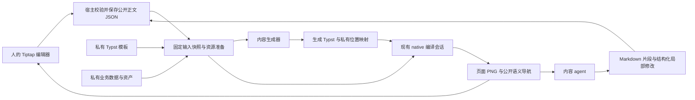

# Typst 内容创作与私有排版边界重构提案

状态：设计收敛稿，待采纳、未实施。设计日期 2026-11-05；2026-11-12 对照 `chore/extract-runtime-labs` 分支的 exports、实现与测试静态复核，状态未变。

本文是一次不保留兼容层的重构设计，不是当前 API 文档。当前实现仍以包 exports、[Typst DESIGN](../../plugins/render/typst/DESIGN.md) 和实际调用方为准。

已确认的产品边界：**外部编辑者可以查看最终页面，但不能取得原始业务数据、模板代码和资产文件。**

推荐方案是：**JSON 正文单向生成 Typst；原生 Tiptap 承担编辑扩展，普通 Typst 模板承担布局，现有编译会话承担排版；宿主拥有存储、业务授权和提交。** 首版交付三个真实演示及其可独立消费的能力，不建立新的文档引擎。设计取舍已经给出，尚未取得的运行时证据集中在第 11、12 节。

现有源码编辑、无源码 DTO 编辑器和 native 编译能力已经落地，正式用法见[源码编辑](../../docs/plugins/rendering/typst-editor.md)。待实现的是 `/content` 的 JSON 校验与生成、持久公开身份、完整渲染快照、按正文单元提交，以及只公开派生图像的输出路径。当前 `/document` 仍向 SourceProject 回写；它不能作为新 JSON 正文模型已完成的证据。

下一轮先核对第 11 节的最小链路：两个 JSON 章节经真实私有模板生成 PNG，并保持跨章引用与准确导航。来源映射、公式隔离及栅格 PDF 的实际质量是替换现有正文存储前的决定性问题；通过后再接入第 8 节的并发提交。下文新 API 均为拟议契约。

本仓拥有 Typst 包、浏览器 consumer 和 `typst-agent-workspace`。[Electron Studio](https://github.com/PluxelJS/lab/tree/main/experiments/electron-studio) 已迁至 Pluxel Lab，拥有自己的应用装配、存储、Monaco 和生成工作区。下文涉及 Studio 的迁移与验收是跨仓库依赖，需要在 Lab 同步完成；本仓文档清理不代表这些应用变更已经实施。

## 1. 核心决定

让外部编辑者直接拥有并编辑公开正文，私有模板只负责把正文排成最终页面。

目前“所有正文都必须以 `.typ` 为权威，再投影成可编辑 JSON”的约束需要收窄。它适用于源码创作，却给只需要 Typst 排版的应用引入了不必要的双向转换。

重构后保留两个独立能力：

- **源码创作**：`.typ` 是权威输入，富文本编辑器是它的结构化编辑视图；允许访问源码的人和 agent 直接使用源码工程。
- **内容创作**：Tiptap JSON 是权威正文，服务端单向生成 Typst，再与私有模板、业务数据和资产一起排版。人使用富文本编辑器，内容 agent 默认使用 Markdown 视图与局部修改；两者提交同一份正文，具体边界见第 8 节。

这不是项目级的 `mode: source | restricted`。同一份成品完全可以由内部人员维护 `.typ` 模板、外部人员维护 JSON 章节、业务系统提供数据。它们拥有不同的事实；**同一段正文不能同时由 JSON 和手写 `.typ` 负责。**

下游通过导入能力、装配视图和提供接口决定使用方式。核心不认识用户角色，不管理 agent，不引入一套 `canReadSource/canEditLayout/canMoveBlock` 权限配置。

代价也要明确：JSON 正文生成的 `.typ` 是可丢弃的编译产物，不能再作为第二个可编辑正文。若业务决定把某份正文改为源码创作，执行一次显式转换并更换权威来源，不提供长期双向同步。

## 2. 当前实现说明了什么

以下结论来自源码与调用方核对，未通过本轮新的运行时实验验证。

| 当前事实                                                                                                               | 证据                                                                                                                                                                          | 设计判断                                                     |
| ---------------------------------------------------------------------------------------------------------------------- | ----------------------------------------------------------------------------------------------------------------------------------------------------------------------------- | ------------------------------------------------------------ |
| `createTypstDocumentProject` 从私有 SourceProject 解析正文，隐藏 import、路径、标签和未知源码；提交时再还原            | [document/project.ts](../../plugins/render/typst/src/document/project.ts)                                                                                                     | 删除这条私有源码与公开正文之间的往返链路                     |
| 隐藏块依赖实例内 HMAC/随机引用 ID，编辑校验还要求占位块序列不变                                                        | [document/project.ts](../../plugins/render/typst/src/document/project.ts)、[document-content.ts](../../plugins/render/typst/src/tiptap/document-content.ts)                   | 不把“未知源码”“固定布局”“业务组件”继续归为一种不可移动占位块 |
| 文档编辑器已经接受 `JSONContent`，底层工厂支持原生 extensions，但 React 包装仍绑定固定占位和 `documentReferences` 分支 | [document-editor.ts](../../plugins/render/typst/src/tiptap/document-editor.ts)、[document-editor-react.tsx](../../plugins/render/typst/src/tiptap/document-editor-react.tsx)  | 保留编辑能力，移除源码投影约束，补足实际需要的组合入口       |
| native 已能从同一次编译取得 PNG、真实字形位置、标签目标和内部链接                                                      | [native/README.md](../../plugins/render/typst/native/README.md)                                                                                                               | 复用现有编译与定位能力，不重建分页器或从 SVG 猜位置          |
| 第三个演示直接提供 `/document-api/asset/architecture` 原始 SVG，并直接调用 native PDF 导出                             | [consumer/server.ts](../../plugins/render/typst/tests/consumer/server.ts)、[document-private/server.ts](../../plugins/render/typst/tests/consumer/document-private/server.ts) | 当前演示尚不满足此次明确的“拿不到原始资产文件”边界           |
| Studio、源码演示和 agent workspace 都有真实源码工程用法                                                                | [SourceProject](../../plugins/render/typst/src/source/state-types.ts)、[agent workspace](../../projects/typst-agent-workspace/README.md)                                      | 保留源码能力，不强迫这些消费者改存 JSON                      |

其中 `writablePaths` 是写入范围。它不使同一编译根里的其他文件变成不可读，也不等价于外部编辑者的隔离边界。

## 3. 名称与事实的所有者

| 概念     | 含义与所有者                                                   | 编辑行为                                                |
| -------- | -------------------------------------------------------------- | ------------------------------------------------------- |
| 排版模板 | 宿主维护的 `.typ`，决定页面、固定表格骨架、页眉页脚、徽标等    | 模板开发者编辑；不作为正文块出现                        |
| 正文单元 | 一章、一节或一个可独立提交的富文本区域；宿主持久化 Tiptap JSON | 使用普通 Tiptap 编辑、重排和跨单元引用                  |
| 插入预设 | 一组普通正文节点的创建快捷方式                                 | 插入后就是普通内容，不保留额外模板身份                  |
| 业务组件 | 宿主定义的语义节点，如“经营图表”或“项目摘要”                   | 用原生 Tiptap NodeView 编辑公开参数，服务端执行可信渲染 |
| 业务字段 | 姓名、申请类型、预算等有业务含义的数据                         | 由业务接口拥有；是否提供编辑器由宿主决定                |
| 渲染产物 | 生成的 Typst、布局、页面、导航数据                             | 可重建；不反向成为正文或业务字段的权威                  |

“模板块”不再作为统称。原先讨论的固定区域属于排版模板；能插入后自由修改的样板叫插入预设；具有独立交互和渲染逻辑的对象叫业务组件。

库不负责保存业务字段的第二份值。字段引用保存公开字段 ID，服务端把它解析为当前值；生成的 `#let`、Typst 字典或者 `/inputs/*.json` 都只是传值方式。引用字段不自动授予字段读取接口或编辑接口。

## 4. 唯一的内容排版链路



源码创作独立使用现有 `SourceProject → 源码编辑器 → 编译会话`。两种创作能力共享编译器、可复用的富文本工具及页面交互，不共享“隐藏源码”的状态机。

保存与排版是两个独立完成阶段。宿主先校验并原子保存正文，再从已接纳内容取得一次排版输入快照，准备资源、生成文件、编译并发布页面。资源准备或排版失败不撤回已保存正文；失败的渲染也不能把旧页面标为新版本。尚未接纳的本地草稿由编辑器宿主持有，首版不另建服务端草稿排版链路。

### 4.1 最小公共能力与默认用法

拟新增 `/content` 入口，包含三个具有不同消费阶段的函数：

| 函数                        | 所有职责                                                        | 不产生的副作用                                    |
| --------------------------- | --------------------------------------------------------------- | ------------------------------------------------- |
| `validateTypstContent`      | 保存前严格校验 JSON 结构、节点、marks 和属性值；成功返回 `void` | 不生成文件、不执行 renderer、不准备公式或业务资源 |
| `emitTypstContent`          | 校验并生成正文文件、入口表和私有来源映射                        | 不读写磁盘、不取数、不创建编辑器或编译会话        |
| `mapTypstContentNavigation` | 将同次生成映射、native 几何和宿主提供的版本信息转换成公开导航   | 不编译、不保存状态、不发布 HTTP 资源              |

校验与生成共享一份内部校验实现；生成入口仍检查输入，不依赖调用方曾经校验过。单独提供校验是为了允许保存有效正文而不依赖排版资源就绪，不引入需要管理寿命的“已校验文档”对象。

普通正文使用与文档编辑器配套的默认 schema 与生成器：

```ts
// 拟议 API：已由宿主读取 JSON；以下两步属于不同操作。
import { validateTypstContent, emitTypstContent } from '@pluxel/plugin-typst/content'

const documents = [{ id: 'reason', document: reasonJson }]
validateTypstContent({ documents }) // 保存入口调用；业务授权、引用和版本另由事务检查。

const generated = emitTypstContent({ documents }) // 排版入口调用。
// generated.files: 受控相对路径 -> Typst 文本；仅供私有构建使用。
// generated.entries: 正文单元 ID -> 对应生成文件；调用方不推导路径。
// generated.mapping: 本次源码范围 -> 正文单元与 ProseMirror 位置；仅留服务端。
```

这段普通正文不包含需要资源绑定的图片、公式或业务节点。图片与公式使用默认生成规则及第 5.4 节的资源绑定，自定义业务节点才补生成规则；不让无资源需求的调用方配置空服务。

自定义正文使用实际安装的原生 schema，`renderers` 只补充或显式替换相应规则：

```ts
const generated = emitTypstContent({
	documents: [{ id: 'reason', document: reasonJson }],
	schema, // getSchema(实际正文 extensions)，不含仅用于 React 展示的依赖。
	renderers, // 同步、可信的节点/mark 函数；需要的数据已经准备好。
})
```

省略 `schema` 使用默认正文 schema；显式传入则完整采用，不再暗加节点。省略 `renderers` 使用默认生成规则；显式规则按节点或 mark 名替换对应默认项，其他默认规则继续可用。规则不能扩张 schema，未知规则名拒绝。新增持久属性必须明确其排版或非排版语义；默认规则不能因节点同名就接受自己不支持的属性。

宿主使用同一正文 schema 校验保存和生成。属性值约束放在原生 attribute `validate` 中，由共享节点定义拥有；默认节点补齐实际接受的值域，不从 `default` 猜测合法类型，也不另维护一份同义业务 schema。未知节点、marks、属性、非法值、重复单元 ID 和非法内容结构均拒绝；只允许 schema 明确声明的缺省值，不静默丢字段或修补结构。schema 中的节点没有生成规则时，生成返回 `UNSUPPORTED_CONTENT`，不输出部分成功文件；应用不能把这种未完成装配的节点宣称为已支持能力。

拟议 `TypstContentError` 使用 `INVALID_CONTENT / UNSUPPORTED_CONTENT / RESOURCE_UNAVAILABLE` 和公开单元 ID、JSON 路径报告可定位的问题；结构合法时可附 ProseMirror 位置。资源不可用只影响排版，不由纯结构校验报告。宿主将这些信号转换为提交问题或预览问题。renderer 的未知异常、IO 和 native 失败保留原错误链，只在公开出口按第 6.3 节处理，不统称为“正文错误”。

生成器不创建 SourceProject，不保存历史，不访问 HTTP，不管理权限。相同正文、schema、生成规则与已准备值产生相同文件和映射；生成时不分配持久 ID，不读取时钟或可变全局上下文。输入全部公开时，下游可以选择浏览器生成；本场景在服务端组合私有输入。`/content` 不加载 React、源码 parser 或 native binding，依赖的正文定义可在无 DOM 环境使用。

不能直接公开当前 `serializeNode` 作为这项能力：它服务于源码回写，包含原始 Typst、import/include 和源码属性语义。可以复用经过审查的纯文本编码、表格等实现，但两条链路各自拥有明确的输入契约。

### 4.2 生成文件与模板组合

正文生成到私有构建目录中的 `_content/`。库将公开单元 ID 编码成无路径穿越、无碰撞的文件名，宿主通过 `generated.entries` 取得路径。该目录由生成器独占；宿主合并模板树时拒绝文件冲突，不以覆盖顺序消解。模板使用普通 Typst `include` 或宿主生成的章节入口组合正文；外部编辑者只见章节标题、顺序和公开 ID。

不把正文源文件放进 `/inputs/`：现有 native 导航会排除该目录，而且现有 `TypstFiles` 只接受 `/inputs/` 动态资源。首版将生成源码放入私有模板树，通过现有 `session.update({ template, files })` 提交完整快照；`files` 继续承载业务 JSON、图像等动态资源。`generated.files` 不是可直接传给 `update.files` 的同型值，不为这个适配立即扩张编译器文件协议。

模板通过正常 Typst 函数和 content 参数排正文。宿主生成的入口可以按章节顺序 `include`，也可以把多个 `include` 的内容作为申请理由、审批意见传给表格模板；无需全局 region/slot 注册或扫描私有模板。

生成文件有自己的模块作用域，不能假定入口文件的局部变量或 import 自动进入被 include 的正文。业务 renderer 在生成模块中显式导入固定的可信函数，传值用编码后的数据或宿主准备的 `/inputs/` 文件；跨模块资源使用明确的项目根路径。[Typst 模块](https://typst.app/docs/reference/scripting/#modules)、[路径](https://typst.app/docs/reference/foundations/path/)

这里选择“生成源码并保留映射”，不同时维护“让 Typst 解释整份 Tiptap JSON”的第二条生产链路。后者容易把多个段落的来源集中到同一个解释函数，增加精确导航的难度。

### 4.3 一次普通正文排版的完整装配

以下是**拟议消费代码**，展示一次导出式调用；交互应用复用同一 session，调度和发布按第 7 节处理。`typst` 是应用已经取得的 `TypstPlugin`，`reasonJson/reasonRevision` 是同次读取的已接纳正文，`signal` 来自宿主任务。三个 `host` 方法属于应用，不是新增库接口：`stage` 将固定私有模板、生成文件与章节入口装配到调用方拥有的临时目录；`publish` 持久化公开 PNG 与导航并返回公开回执；`reportRenderFailure` 保留私有诊断并返回公开诊断编号。

```ts
import { emitTypstContent, mapTypstContentNavigation } from '@pluxel/plugin-typst/content'

async function renderAcceptedContent() {
	try {
		let artifact
		{
			const generated = emitTypstContent({ documents: [{ id: 'reason', document: reasonJson }] })
			// stage 返回 root/entry、现有 TypstFiles 和删除临时目录的 AsyncDisposable。
			await using staged = await host.stage(generated.files, generated.entries, { signal })
			await using session = await typst.open({ root: staged.root, entry: staged.entry }, { signal })
			const compiled = await session.update({ files: staged.files, signal })
			const renderId = crypto.randomUUID()
			const navigation = mapTypstContentNavigation({
				mapping: generated.mapping,
				navigation: compiled.preview.navigation,
				renderId,
				documents: [{ id: 'reason', revision: reasonRevision }],
			})
			const pages = []
			for (const page of compiled.preview.pages) {
				const image = await session.renderPage({
					revision: compiled.revision,
					page: page.page,
					signal,
				})
				pages.push({ page: page.page, png: image.data })
			}
			artifact = { renderId, navigation, pages }
		} // 先关闭 session，再删除构建目录；公开页图已取得独立字节。
		return await host.publish(artifact, { signal })
	} catch (error) {
		const diagnosticId = await host.reportRenderFailure(error)
		return { status: 'render-failed', diagnosticId } // 正文先前已保存。
	}
}
```

`stage` 自行清理创建失败的半成品；`publish` 先存放页图，最后原子发布清单和回执，不透传 compiled 或 mapping。成功发布后的取消不能改写已发布回执。该示例在关闭资源后才发布完整页图，不再依赖 native document；交互预览则可以按页请求，只保留第 7.2 节允许的版本。不把某次 HTTP 等待结束自动解释为撤回已保存正文。

这里的装配代码应首先在演示宿主中实现。两个真实消费者重复同一段无业务策略的转换时再提取普通函数；不因“宿主负责”让每个应用重写编码、映射和版本校验，也不预先抽象存储 adapter 或 ContentProject。

### 4.4 输入快照与资源寿命

宿主拥有正文存储、业务数据、访问控制、提交事务和持久化历史。库拥有编辑器、生成器和现有编译会话各自的契约。

宿主先固定正文版本、目录顺序、模板及业务输入，再准备图表、图片和隔离公式。数据库内的数据使用同一读取事务；文件和外部资源使用捕获的字节或不可变版本。无法固定的数据源返回准备失败，不在逐节点生成时反复读取“最新值”。这保证一次成品使用明确的一组输入，不宣称跨任意系统获得全局原子快照。

生成器只消费准备完成的值；renderer 同步执行，异步函数或返回 Promise 明确拒绝。IO、公式计算、重试和取消都在宿主准备阶段，不混入节点遍历。输入快照、生成源码及映射在 native 接纳期间不可变；生成文件不修改调用方模板原件。staging 必须保持生成文本的原始字节，不再次格式化、转义或拼接进另一个文件后仍使用原映射。

宿主将私有映射与对应 retained native document 关联，并在产物替换或会话关闭后释放。已复制的公开 PNG 和导航可以作为旧预览保留，但不能继续承诺旧 native 文档可查询。缓存只保留有明确预算的输入或产物；不新增重复管理编译、缓存和任务的长期对象。

## 5. 自定义组件、字段与固定区域

普通表格仍是 Tiptap table 节点。只有有业务规则的交互，才需要业务组件。无需把所有 UI 都包装成自定义组件。

### 5.1 编辑能力直接组合原生扩展

`/tiptap/document` 拟提供 `createTypstDocumentExtensions`，由编辑器工厂和下游 `getSchema()` 共用。默认正文覆盖现有必要的段落、marks、列表、表格、图文、数学和引用能力，移除源码节点与固定占位协议；涉及资源的节点仍需要对应服务端绑定。React 包装使用同一工厂，不私下再装一套不同 schema。

自定义 `extensions` 按名称替换顶层默认项并追加新项，显式传入的同名项直接拒绝。替换 StarterKit、TableKit 等组合内部的成员时，先用组合的原生配置禁用该成员，再安装替代扩展；完整展开后仍有重名则报错，不按顺序暗选一个。不要为同名覆盖另造递归扩展合并器。[Tiptap StarterKit 配置](https://tiptap.dev/docs/editor/extensions/functionality/starterkit#configure)

只改变 NodeView、菜单或快捷键时无需改生成器。改变持久节点、marks 或属性契约时，必须同步服务端 schema 与生成规则。公开节点定义与属性校验放在不依赖 DOM 的共享模块，React NodeView 和私有 renderer 分别从客户端、服务端入口导入。服务端直接构造 schema，无需创建 Editor；浏览器与服务端的持久节点契约必须一致，不要求安装相同的 UI 插件。不要把服务端 renderer 挂进浏览器会加载的扩展对象。

编辑器实例只随实际 schema/历史所有者变化而重建；正文回显、引用目录更新和预览刷新不重建实例。宿主可直接取得原生 Editor 组合工具栏与选区行为，不再添加与 Tiptap 命令同义的控制器。

### 5.2 一个业务图表的完整扩展边界

可引用的经营图表直接组合现有 figure、标题和一个业务节点；业务节点只保存公开对象 ID：

```json
{
	"type": "figure",
	"attrs": { "id": "figure-sales-1" },
	"content": [
		{ "type": "businessChart", "attrs": { "objectId": "chart-quarterly" } },
		{
			"type": "figureCaption",
			"content": [{ "type": "text", "text": "本季度经营情况" }]
		}
	]
}
```

figure 的 `id` 是正文中可引用实例的身份；`objectId` 是宿主业务数据的绑定身份。复制 figure 生成新的 `id`，保留 `objectId`，因此可以在不同位置展示同一份业务数据而不混淆引用。标题复用普通可编辑子内容，不把一套标题、编号、label 和复制逻辑塞进每个业务节点。

默认 figure 用原生 schema group `typstFigureBody` 允许 image、table 和显式加入该 group 的自定义节点，结构仍为一个 body 加一个 figureCaption。这是 Tiptap/ProseMirror 的内容约束，不是另一个组件注册系统。不需要被引用的业务块可直接作为普通 block 使用。

宿主安装原生 Tiptap 节点及属性校验、可信生成器；确有交互需求时再提供 NodeView。JSON 不包含数据路径、资产路径、JSONPath、模板函数名或用户传入的 Typst 表达式。NodeView 负责公开参数，renderer 闭包只使用本次已经准备好的私有绑定。

对象绑定只接受本次文档明确提供的公开对象 ID；任意猜测一个 ID 不能读取其他文档的数据。引用目录和业务对象访问由宿主已有业务边界检查，不由核心发明一套新的授权协议。

以下是**拟议扩展代码**，接在第 4.3 节生成之前；`BusinessChart` 由下游共享模块导出，定义 `objectId` 的合法值，作为 atom 加入 `block typstFigureBody` 两个原生 group。服务端取数阶段已经得到只含本篇授权对象的 `charts`；前端使用同一扩展定义，交互视图通过原生 `addNodeView` 增加。

```ts
import { getSchema } from '@tiptap/core'
import { createTypstDocumentExtensions } from '@pluxel/plugin-typst/tiptap/document'
import { emitTypstContent } from '@pluxel/plugin-typst/content'
import { BusinessChart } from './business-chart.shared'

const extensions = createTypstDocumentExtensions({ extensions: [BusinessChart] })
const schema = getSchema(extensions)
const generated = emitTypstContent({
	documents,
	schema,
	renderers: {
		nodes: {
			businessChart(node, output) {
				const chart = charts.get(node.attrs.objectId)
				if (!chart) throw new Error('Prepared chart binding is missing')
				output.syntax('#{ import "/components/chart.typ": chart; chart(')
				output.value(chart.values)
				output.syntax(') }')
			},
		},
	},
})
// 后续仍使用同一 staging、session、导航转换和发布流程。
```

私有模板的 `chart` 函数返回图表内容，外围 figure 的标题、编号、实例 label 与引用由默认生成器处理。业务 renderer 不自行拼 label，也不承诺图内每个数据点具有正文字符位置；插入预设只需创建上面的普通节点树。缺少绑定属于准备/装配失败；猜测未授权 `objectId` 则应在宿主提交检查时拒绝，不能等待 renderer 代做授权。

### 5.3 renderer 的职责止于受控源码生成

生成回调按文档顺序、节点树与原生 marks 顺序同步执行；同一次生成不并发，首个失败终止本次结果。回调不可依赖跨调用次数或修改输入；重试和重新排版可能再次调用。输出器仅在当前回调内有效，不可缓存到下一次生成。

拟议输出器只有必要的写入能力：`syntax` 写可信代码；`value` 将字符串、有限数值、布尔、空值及其数组/普通对象编码为 Typst 数据表达式；`content` 生成当前节点的子内容，或在 mark 回调中继续剩余 marks 和正文。拒绝函数、非有限数值、循环对象等不支持的值；`value` 的字符串永远不解释为源码、label 或尺寸表达式。

库在回调外自动记录当前节点来源范围，默认文本生成器维护转义前后的字符对应，`content` 保留子节点来源。自定义组件及属性派生文本默认只有节点精度；renderer 无需自行计算字节偏移或伪造字形坐标。空输出也必须符合节点的声明语义，不能借此静默忽略不支持的正文。

`syntax` 是可信代码的扩展点，不是安全沙箱；外部 JSON、字段值和模板路径不得直接传入它。路径由宿主绑定选取，尺寸、颜色等先校验再走相应生成规则。首版用这些局部写入能力满足真实 renderer，不另建 Typst AST、模板 DSL、跨运行时插件注册表或任意代码上传入口。

### 5.4 图片、字段与固定内容

NodeView 可以展示参数控件、占位内容或允许公开的栅格化效果。不能为了让编辑器显示徽标，就直接提供原始 SVG 文件。

正文图片保存公开资源 ID，由宿主上传/选择接口管理，服务端解析到本次快照中的受控资源。编辑器中的栅格预览 URL 是派生展示值。默认内容入口不接受任意 `src` 作为服务端取图地址；使用原生 image 扩展时显式调整其属性和视图，不能把开放 URL 取图藏进默认生成器。客户端粘贴的未接纳图片保留本地待上传状态，不伪装为已保存资源。

`emitTypstContent` 的可选 `resources` 接受两个同步解析函数：`image(assetId)` 返回已准备的受控资源路径；`formula({ latex, display })` 返回隔离后的栅格路径及宽、高、基线度量。它们只查本次准备好的映射，不执行 IO；缺少对应解析函数或资源时返回带节点位置的 `RESOURCE_UNAVAILABLE`。路径由宿主放入现有 `/inputs/` 资源表，不直接取自 JSON。公式的字号/字体策略由本次准备配置固定，度量以明确的基准字号归一化供模板缩放；其精确类型与基线实现必须通过第 11 节样本，不假定能从最终模板任意计算规则反推公式样式。这是两个局部 callback，不是资源服务接口或缓存管理器。

普通业务组件默认可以作为正文移动、复制或删除。若某个审批结论必须固定存在，优先把它放到私有模板或独立业务区域。确有“正文中的固定对象”需求时，由该节点的扩展和宿主提交校验共同表达该业务约束；核心不根据节点未知、私有或不可编辑推导“必须固定”。

字段编辑也是组合问题：提供某字段的表单与 setter，用户就能编辑；只提供正文中的字段引用，用户就只能插入引用。没有编辑需求时，不要求开发者额外写“禁止编辑”代码。已有业务表单可以直接复用，不为所有字段生成一个通用权限面板。

## 6. 保护的是输入与执行环境

浏览器和内容 agent 取得：公开正文、必要的公开引用目录、宿主明确公开的组件参数、最终页面及其语义导航。它们不取得：模板源码、原始数据集、原始资产、私有文件清单、原始 source map 或私有编译诊断。

**最终页面中出现的文字、数值和图形外观已经公开。** 本设计不承诺阻止截图、OCR、重新描绘图标或从已展示数字进行推导，也不能把一个页面上显示的值继续称为保密值。

### 6.1 任意源码不能进入私有排版环境

只在 UI 隐藏 `.typ` 不构成边界。若外部提交的任意 Typst 与私有输入一起执行，它可能通过读文件或排版把私有输入带到最终页面。

因此，内容入口只接受经过校验的正文和公开参数。字符串按数据编码；路径、label、尺寸和颜色等分别使用受控生成规则。禁止把文本、组件属性、公式或链接直接拼进可执行源码。仅转义一个总字符串不足以覆盖所有输入通道。

可以给可信源码作者完整 Typst 工程。若某个外部作者可以编辑 Typst，却仍不能接触私有资产，则他的源码只能在不含这些私有输入的独立编译环境中执行，最终产物再交给宿主组合；不能靠 `writablePaths` 实现。Typst 的文件访问以编译根为边界，具体运行环境还需以本地绑定验证。[Typst 文件路径文档](https://typst.app/docs/reference/foundations/path/)

### 6.2 公式必须单独处理已发现的执行路径

当前固定的 MiTeX 资源含 `eval`：不仅转换结果会被求值，部分间距/偏移命令也对参数求值。可在 [mitex-files.json](../../plugins/render/typst/src/tiptap/mitex-files.json) 核对。这证明存在需要审查的执行路径，**不等于本轮已经证明了可利用漏洞**。Typst 官方也明确 `eval` 会求值源码字符串。[Typst eval 文档](https://typst.app/docs/reference/foundations/eval/)

本方案不把外部 LaTeX 直接交给能读私有文件的 MiTeX 环境。选定的最小隔离路线是：在仅含公开公式、必要的公开数学资源与字体的编译环境中生成公式图像和尺寸/基线，再由私有模板组合该产物。沿用现有编译能力，不要求另部署一套网络服务。

公式预处理发生在第 4.4 节的资源准备阶段；同批相同公式及渲染参数可以复用一次结果。独立 Worker 本身不证明文件隔离：必须检查本地 binding 的文件解析、包加载、字体来源和真实路径边界，证明公式环境无法读取私有工程或借共享资源指回私有文件。若现有能力无法表达这个边界，先补足隔离再继续迁移。输入大小、计算时限和输出像素沿用实际资源预算，不允许一个公式无限占用编译资源。

首次实现采用栅格公式产物；公式内容仍以原生数学节点保存并可编辑，预览定位到公式节点。代价是放大精度，需要验证行内基线与目标输出清晰度。若之后要换成向量产物，应在隔离环境边界验证其引用与元数据，而不是重新把不受约束的求值放回私有编译环境。

这项隔离只用于接受外部公式的内容装配。可信源码创作保留既有公式能力。

### 6.3 页面、下载与错误的出口

公开预览使用 native 渲染的页面 PNG，加上必要的语义导航。PNG 只由已渲染像素重新编码，不夹带源码、原始资产或私有元数据。

第三演示的原始 SVG 路由应删除。私有组件在编辑器中的效果改用公开页面片段或服务端重新生成的栅格图；改一个不透明 URL 名称不能保护原文件。

原生 PDF/SVG 导出也不能直接满足相同边界：PDF 可能嵌入原始图像，SVG 会暴露矢量路径，附件和元数据还可携带额外信息。本地 native 锁定的 Typst 0.14.2 PDF 图像实现存在直接使用 JPEG 字节的路径。[Typst 0.14.2 图像导出实现](https://github.com/typst/typst/blob/v0.14.2/crates/typst-pdf/src/image.rs)、[Typst PDF 附件](https://typst.app/docs/reference/pdf/attach/)

第三演示若保留下载按钮，出口改为**仅由公开页面栅格图组成的 PDF**，仅加入允许公开的元数据；不把原生 PDF 清理几个字段后直接发布。代价包括文本选择、搜索、无障碍结构和放大质量。本次提案选择满足已确认的输入保护边界；原生矢量 PDF 导出仍保留给有权取得它的源码/内部应用。

用户正文错误返回公开节点位置和可理解原因；私有模板错误返回稳定错误码与诊断编号，详细源码诊断留在服务端。公开链接也由宿主判断目标 URL 是否允许发布，不能仅检查 scheme 就把包含私有路径或参数的链接送出去。

## 7. 预览互动仍由真实编译结果驱动

新的映射链为：

`公开 JSON 位置 → 生成 Typst 源码范围 → native 编译几何 → 公开 JSON 位置与页面坐标`。

源码范围和私有路径只留服务端。客户端继续使用 `TypstDocumentPreview` 处理页面点击、光标跟随和内部链接；该组件本身不需要知道 JSON 来自数据库还是本地状态。

必须同时满足：

- 编辑器点击正文，预览定位到该正文真实排版位置；预览点击正文，打开对应章节并设置选区。
- 引用、目录和页面内跳转使用 native 的实际目标位置。目标在私有模板中时可以只跳页面，不伪造一个可编辑正文位置。
- 同一正文被重复包含时允许一对多位置；跟随选择优先当前页面附近的实际出现位置。
- Unicode、转义和连字按真实源码/字形映射转换。不能靠字符数、标题匹配或文本搜索猜位置。
- 无精确字形来源的计算内容、公式图片和部分代码块明确采用节点范围定位，不承诺虚假的字符精度。现有 native 对多行/含 tab 的字符串形式 `raw` 有来源限制，生成策略须据此验收。

记录生成源码范围并不自动证明组件可以命中：私有函数生成的图形可能只携带模板内部来源。对这类原子内容，由生成器附加仅对本次快照有效的私有定位标记，并通过 native 的实际目标/元素几何建立节点关联；必要时最小扩展现有 native 提取。只有锚点时不虚构整个组件的矩形，重复 include 的各次出现也必须分别对应实际位置。第 11 节样本须验证组件点击与正文揭示，不能只证明普通段落有字符坐标。

公开定位至少包含正文单元 ID、该单元版本及当前 ProseMirror 位置。长期引用使用持久 ID；数字位置只对特定快照有效，不作为 agent 的永久书签。

`mapTypstContentNavigation` 只输出白名单中的公开字段，不直接透传 native 对象。正文目标和固定模板目标的关联都从生成映射取得，固定目标绑定见第 8.2 节。外部 URL 默认不发布，只有宿主提供的 `allowUrl` 对完整 URL 判定通过才加入导航；未声明的模板目标仍可作为同份成品中的页面坐标，不暴露 label 或文件路径。

### 7.1 身份分别回答不同问题

| 身份                          | 回答的问题                             | 所有者与寿命                 |
| ----------------------------- | -------------------------------------- | ---------------------------- |
| 单元 ID 与 revision           | 正在编辑哪一份正文，位置是否仍有效？   | 宿主持久化，提交时检查       |
| requestId 与 commitId         | 这次写入是否已经接纳，如何重试或撤销？ | 宿主提交记录，见第 8 节      |
| renderId                      | 页面、导航与哪一组完整输入对应？       | 宿主渲染记录；对外不透明     |
| native session ID 与 revision | 哪个编译会话仍可渲染这份产物？         | 现有 native 会话；只留服务端 |

`renderId` 绑定公开正文版本、目录、模板、业务数据、资产、字体、编译器及相关生成配置。仅正文 revision 不足以识别一次排版；模板或私有数据变化也会改变几何。首版用不透明 ID 关联内部输入快照、映射和 native 修订即可，不要求把所有资源构造成哈希依赖图。

页面图片与导航必须属于同一个 renderId。私有输入变化后，宿主通知预览失效；即使正文 revision 不变，也不能继续用旧几何响应点击。存在未接纳的本地输入时保留旧页面但禁用正文联动，显示真实的等待/错误状态。原生文档内部跳转也不能混用两个渲染版本的数据。

### 7.2 接纳、编译与发布的时序

一次正文保存先返回 commit 收据，再提出新的预览需求；私有输入变化也提出需求。每个预览会话至多运行一项准备/编译任务，并保留一个可替换的最新需求。待处理项只记录目标版本或需要重排，实际启动时才按第 4.4 节取得快照和准备资源；不在每次输入时提前复制模板、资产或生成公式。合并的只是尚未开始的预览工作，不合并或丢弃已接纳的正文提交。

任务取得快照后只使用该快照。结果完成时重新检查需求是否仍当前：过期成功结果不发布为当前预览；实际故障仍进入诊断记录。新结果在编译、导航转换及所需初始页图准备完成后整体发布，客户端按 renderId 接纳结果和异步页图响应，不让晚到图片替换新页面。

交互页图按页请求。请求携带 renderId，服务端核对访问权限及其关联的 retained native revision；已经释放的版本返回明确的过期结果，不偷偷改渲染最新页。native 已有队列和修订检查负责执行串行化，宿主只负责需求合并与发布判断，不再创建线程池或任务框架。

现有 native 只保留最新成功 document。新编译替换后，旧页面若已复制到浏览器或公开缓存，可以继续显示为“旧预览”；尚未取得的旧页不能承诺补取。首次实现保留当前产物和有界旧页缓存，不为了稳定 URL 增加无限历史 native 文档。下载任务按确定的 renderId 取得完整页图后再生成栅格 PDF；若中途版本过期，明确失败，不能混页。

UI 分别表示“未提交/提交中/已保存/冲突”和“等待排版/排版中/可用/排版失败”。输入始终由本地编辑器响应；保存收据和预览就绪不互相冒充。正文冲突保留草稿，排版失败保留已保存内容和带版本标识的旧页；定位是否可用从单元版本、renderId 与草稿状态得出，不再维护一份可漂移的布尔事实。

### 7.3 首版性能策略

复用已有 session、native memoization 和按页栅格化。连续输入只替换待处理预览，默认不终止正在运行的 native 编译：当前在途取消会终止 Worker 并关闭会话，不能作为每次按键的常规更新方式。真正取消或超时沿用现有失败和关闭契约，恢复时显式重新打开会话。

生成文件名保持稳定，宿主更新私有构建目录时仅写变更文件并删除明确移除的生成文件，不重置整个工作目录。现有 `update.template` 仍会捕获完整模板树；减少宿主重写不等于已经消除模板复制成本。先测量该成本，只有成为瓶颈后才在原会话契约内优化快照传递。

首版允许每次重新遍历当前正文并生成源码；按章存储不承诺按章独立分页。测量证明生成或公式准备成为瓶颈后，再引入有界单元缓存或公式缓存，键必须覆盖全部实际输入与生成配置。不可用跨请求共享可变 renderer 闭包换取缓存命中；限制输入规模、输出字节、像素和会话数沿用实际资源预算。

宿主在解析和接纳边界限制正文请求大小，校验遍历限制节点数与嵌套深度；native 的输入/执行限额不能替代生成之前的成本控制。具体阈值从目标文档规模确定，不先暴露一组未经测量的缓存或并发调参项。

## 8. Agent 使用 Markdown 写作视图，共享 JSON 正文

允许看源码时，agent 继续使用已授权的源码工程和现有文件/编译工具。不给源码时，**默认提供按需读取的 Markdown 正文视图和可写范围，普通写作提交 Markdown 片段；宿主将修改应用到同一份 Tiptap JSON。** JSON 仍是存储、schema 校验和编辑器的权威表示，agent 只在结构检查或复杂修改时按需读取局部 JSON。

权威格式不要求等同于 agent 的主要交互格式。分章读取能减少上下文，却不能消除 JSON 中重复的 `type/content/attrs/marks`、括号和转义。Markdown 适合表达段落、标题、列表和强调；是否实际降低 token、出错率和任务耗时需要按第 12 节比较。只保存 JSON，不保存一份需要持续同步的 `.md` 正文，也不从 Markdown 直接生成 Typst 绕过现有校验链路。

### 8.1 阅读视图与有边界的 Markdown 写入

先给公开章节目录、内容能力说明和任务所需章节。读取结果包含单元 ID、revision、Markdown、可替换范围及必要的公开对象目录；这些定位信息由工具返回，agent 不手算 ProseMirror 位置。完整 schema 和对象 JSON 按需获取，不在每次写作请求中重复展开。

例如，阅读视图可以呈现为：

```md
## 本季度经营情况

本季度的重点是**改善回款周期**，同时控制新增项目风险。

- 优先处理逾期应收款。
- 对新项目分阶段投入。

[经营图表：季度营收](content-object:figure-sales-1)
```

这里的 `content-object:` 是拟议阅读视图中的公开对象链接，只标识已有 figure；它不是资产下载地址，也不代表可解析回完整图表的 Markdown。写入时遇到这种阅读链接明确返回结构化操作提示，不能存成普通超链接冒充原对象。图表仍可通过对象操作移动、复制、删除或修改公开参数。

首版按实际表达能力选择写法：

| 内容或操作                                     | agent 的主要表示                           | 接纳边界                                                                        |
| ---------------------------------------------- | ------------------------------------------ | ------------------------------------------------------------------------------- |
| 普通段落、标题文字、列表、强调、引用块、代码块 | Markdown 片段                              | 只开放已验证的节点、marks 和属性子集；已有标题的 ID 由明确的目标容器保留        |
| 新建普通正文单元                               | Markdown                                   | 解析成 JSON，再按普通创建流程分配需要的身份并提交                               |
| 引用、图片、公式                               | 经验证的简短 Markdown 表示或结构化插入操作 | 必须恢复真实 `targetId`、资源 ID 或数学节点；未实现对应转换时明确使用结构化操作 |
| 已有业务图表、字段绑定、复杂表格及特殊样式     | 阅读视图中的公开说明；需要时读取局部 JSON  | 使用对象/节点修改，不能从展示标题猜测原节点或私有数据                           |
| 纯 Markdown 可完整表达的正文单元               | 可以整体替换 Markdown                      | 先证明该单元的全部持久语义在转换范围内；含未覆盖属性或对象时不开放整章替换      |

写入目标包含 `{ documentId, revision, from, to, kind }`，其中 `documentId` 是正文单元 ID。范围由宿主从当前快照提供，同时返回该范围可原样提交的 Markdown 片段；整章阅读视图不等于可写片段。首版只提供两种边界：

- `inline`：替换一个普通段落、标题或图注的完整行内内容，保留外层节点、ID 和属性；提交块级语法时拒绝，不自动展平。
- `blocks`：替换同一父节点内的连续完整块，或在合法块边界插入；不切穿列表、表格或 figure。解析结果必须直接满足父节点 schema，不自动包裹、提升或删节点来凑成合法结构。

宿主重新检查范围、kind 与可写能力，不能信任客户端回传的定位。位置只在该 revision 有效；版本改变后重新读取，不以标题或字符串搜索猜位置，也不为每个段落增加持久 ID。

宿主将 Markdown 解析成受支持的 JSON fragment，在读到的基线上仅替换明确范围，再交给第 8.3 节的同一提交边界；重试沿用第 8.4 节的原始请求收据。局部修改仍按单元接纳，不承诺细粒度自动合并。批次内多个范围使用同一基线，重叠范围或同位置的多个插入明确拒绝。

未修改的节点直接沿用原 JSON。若选定范围本身包含 Markdown 无法表达的 marks、属性或业务节点，则要求缩小范围或使用结构化修改，不能把它们导出时隐藏、导入时猜回。含持久 ID 的标题不开放整块 Markdown 替换；改文字使用 `inline`，改层级使用结构化属性操作。整章替换也不能绕过这一检查。

转换优先使用 Tiptap 原生 Markdown 能力及节点的 `parseMarkdown/renderMarkdown`，普通节点不另写一套 AST。业务节点只有确需文本编辑且有完整语义映射时才补转换规则；首版不发明承载所有 JSON 属性的 Markdown 方言。Tiptap 官方目前将 Markdown 标为 Beta，并列出评论、多子节点表格单元格等表达限制，因此必须验证项目实际支持的范围。[Tiptap Markdown](https://tiptap.dev/docs/editor/markdown)、[原生扩展接入](https://tiptap.dev/docs/editor/markdown/guides/integrate-markdown-in-your-extension)

现有 [document-nodes.ts](../../plugins/render/typst/src/tiptap/document-nodes.ts) 的 figure Markdown 输出只是子内容展开，[document-editor.ts](../../plugins/render/typst/src/tiptap/document-editor.ts) 的引用输出可退化为标题；它们不证明身份、属性和引用可往返。先在宿主内容工具侧验证转换，所需 Markdown 依赖也放在该消费边界，不让普通 `/content` 使用者加载 Markdown 转换或 agent 工具。

开放写入前至少验证：未修改的受支持片段经过 JSON → Markdown → JSON 后保持完整持久语义，仅允许已声明的缺省值和等价文本节点表示差异；修改一段正文不改变邻近图表、引用 ID 或容器属性。解析后不能把不支持的语法静默丢弃再保存。原始 HTML、任意资源 URL、Typst 表达式和组件执行代码不通过 Markdown 获得额外能力，公式仍进入第 6.2 节的隔离路线。

agent 可以查看同一个最终页面检查排版，但不能借此获得私有诊断、资产下载或任意服务端执行工具。Studio 内部的源码 read/write/bash 工具不能直接复用给内容 agent；当前 `typst-agent-workspace` 的源码权威也不因此改回 Markdown。

### 8.2 持久身份

章节和可引用对象拥有持久公开 ID。重启、改名、调序和移动保持身份；复制生成新 ID，并明确重写副本内部指向被复制对象的引用。对外部对象的引用继续指向原对象。

上述复制规则作用于正文实例身份，不作用于 `objectId`、字段 ID 或资源 ID 等业务绑定。图表优先复用第 5.2 节的 figure 身份，避免每种业务节点各造编号和引用协议。移动必须作为删除原位置与加入新位置的原子操作；服务端检查最终状态，不能因临时处理顺序误报重复 ID。

引用节点使用 `targetId`，不伪装成私有 Typst `label`。标签由服务端派生；标题、编号、页码和当前位置从当前正文与编译结果得到。固定模板对象也可以拥有宿主明确公开的 ID。

生成器收集本次全部正文单元中的可引用 ID，统一派生内部 label。固定模板目标通过 `emitTypstContent` 的可选 `targets: [{ id, label }]` 提供；该表只由可信宿主构造，不能从用户 JSON 指定 label。重复 ID、与正文目标冲突或无法解析的引用明确失败。生成结果的私有 mapping 同时携带这些关联，导航转换不再要求调用方维护第二份 label 表；目标是否实际出现在成品、页码和位置由本次 native 结果决定。

ID 在显式创建、复制或粘贴新对象时分配，并随该次编辑进入历史。浏览器的原生扩展与 agent 的创建操作遵守同一规则；普通读取、保存校验和生成不补发或修复 ID，提交缺失或重复身份时明确失败。远端内容回显也不能触发重新分配。

只给实际可引用的 heading、figure、独立公式等节点配置身份行为，普通段落继续用版本内位置。优先用原生扩展处理选定节点的 ID；复制与粘贴正文片段共用身份重建和内部引用重写逻辑，不能只消除重复 ID 而留下错误引用。分割标题与撤销也需实际验证。[Tiptap UniqueID](https://tiptap.dev/docs/editor/extensions/functionality/uniqueid)

### 8.3 宿主提交契约：单元版本与原子批次

以下是第三演示宿主的协议草案。`documents` 绑定宿主业务文档（整份报告），其中的 `id` 标识正文单元（章节）；与第 8.1 节的 `documentId` 同义。报告的授权与存储范围由宿主接口确定，不由单元 ID 或页面会话推断。人类与 agent 使用同一接纳边界。

```ts
await documents.edit({
	requestId: 'operation-uuid',
	expected: [
		{ id: 'methods', revision: 12 },
		{ id: 'background', revision: 7 },
	],
	documents: [{ id: 'methods', document: editedJson }],
})
```

`expected` 包含所有写入单元，也可以包含此次判断依赖的只读单元。服务器在同一个存储事务中检查现有授权、版本、schema、全局 ID 和引用，再一起写入。成功返回接纳后的单元版本、整体内容 revision 与 commitId；失败保留 `CONFLICT / READ_ONLY / NOT_FOUND / INVALID_EDIT` 等稳定信号，不产生部分写入。

共享文档以文档 ID 定位唯一持久状态，页面 lease 和编译会话不各自维护可独立提交的权威副本。提交比较与写入必须由同一事务或宿主存储的原子提交保护；进程内 promise 队列只能用于已明确的单进程演示，不能冒充多进程并发保证。

按章修改不因无关章节变化而冲突。章节创建、删除、调序使用宿主目录自身的版本；涉及正文和目录的操作同批提交。整体内容 revision 用于描述成品快照，不能拿它阻止所有独立章节的并行编辑。

引用有效性针对“当前已接纳内容加上本批修改”检查。删除仍被引用的对象，返回受影响的公开单元；调用者在一个批次内同时修订引用。自然语言意义上的依赖由调用者放进 `expected`，系统不猜测一句结论依赖哪些数字。

若判断依赖成品中的业务数字、字段或排版结果，提交另外带 `expectedRenderId`。宿主检查该渲染所绑定的输入快照是否仍当前；私有数据变更即使未改变正文 revision 也会冲突。记录已过期或无法核对时明确拒绝，不假定未变。纯正文润色省略此条件，避免所有独立章节被无关排版变化互锁；重新编译相同输入也不必仅因 ID 不同而冲突。

当前输入版本指针的检查与正文写入处于同一接纳事务；外部数据先由宿主接纳为有版本的快照，再参与这项比较。不承诺检查到接纳之间没有保护的外部“最新值”。渲染快照元信息可按宿主声明的期限保留，无需同时保留 native document。这个条件复用已有快照，不建立自然语言依赖分析或通用业务版本协议。

### 8.4 并发、草稿、重试与撤销

同一编辑器对同一正文单元最多有一次在途保存，后续输入留在当前本地草稿。回执只确认该请求送出的内容和版本；等待期间又有输入时，保持“未提交”，以新接纳版本作为下一次保存的基线，不能用回执中的正文覆盖新草稿。失败时保留草稿；结果不明时先按原 requestId 查收据，不继续提交依赖未知基线的新请求。

启动 agent 任务前，等待中文输入法当前组合完成，固定当时的正文并取得保存收据，给 agent 一个明确基线；失败或冲突时不启动写入任务。等待期间与启动后均允许继续输入，后续变化按上述保存流程及提交版本检查处理。

人类和 agent 同时修改同章时，先接纳的提交成功，后者冲突。**远端整章更新不能用 `setContent` 覆盖尚未提交的人类草稿。** UI 保留本地稿，呈现远端变化，允许重新协调；agent 重新读取后生成新提交，不得只换 revision 盲目重投旧 JSON。

宿主把 requestId、请求内容标识和提交收据与正文一起持久化。在声明的保留期内，相同请求重试返回同一收据；同 ID 不同内容拒绝。先查收据再做版本检查和 Markdown 范围转换，防止响应丢失后重做已经成功的修改；请求标识基于原始操作，不基于重新读取后计算的 JSON。

重试先核对当前调用者是否仍有权访问该文档与收据，再按文档和调用者范围查 requestId，不能用猜测 ID 读取他人提交。请求内容标识由服务器根据已校验请求稳定计算；客户端不自行拼内部 key。收据已超出保留期且结果不确定时先重新读取正文与历史，不承诺无限期 exactly-once，也不自动换 ID 重做写入。取消 agent 或断开请求不会撤销已经持久化的提交。

本地未提交输入使用编辑器原生历史。已接纳的 agent 批次保存所改正文的 before/after，撤销通过同一提交边界提交反向修改；涉及单元又变化时冲突，不回退其他人的无关章节。远端整章替换形成明确历史边界，第一阶段不承诺跨远端替换无缝恢复每次按键历史。

一个验收例子：方案章 A v12 有 `table-x`，结论章 B v7 引用它。人类修改 A 到 v13 后，基于 A v12 的 agent 提交必须冲突；只润色 B 的 agent 仍可提交。若 B 的修改依赖 A 的旧数字，应同时检查 A v12。若要删除 `table-x`，必须在一个批次里修订 A 和 B。

### 8.5 先不引入 CRDT

按章并行、原子关联修改和显式冲突已经覆盖当前 agent 协作目标。先不自造 JSON merge，也不预装协同服务。

如果实测需求变成多人持续修改同一段并自动合并，则采用原生 ProseMirror 协作或 Tiptap/Yjs。选用 Yjs 后，由同一份协同文档拥有状态，JSON 是其导出/业务表示；agent 也把修改接入协同事务，不能继续把整章 `setContent` 当成协同写入。历史和选区使用对应生态能力。[Tiptap Collaboration](https://tiptap.dev/docs/editor/extensions/functionality/collaboration)、[Yjs 相对位置](https://docs.yjs.dev/api/relative-positions)、[Yjs UndoManager](https://docs.yjs.dev/api/undo-manager)

## 9. 下游组合与三个演示

共用一个 Worksplit 页面及现有编辑器/预览分栏。侧边栏由演示应用装配，不由核心“源码可见模式”切换。保持桌面工作区定位，不新增手机布局任务。

| 演示           | 权威输入与装配                                         | 用来证明什么                                                        |
| -------------- | ------------------------------------------------------ | ------------------------------------------------------------------- |
| 普通多文件报告 | `.typ` 工程、文件树、源码/富文本标签、预览             | 源码作者和源码 agent 保持自然的 import、include、重命名与跨文件引用 |
| 项目申请审批表 | 私有表格模板、业务字段、申请理由与审批意见的 JSON 正文 | 固定布局与自由正文能直接组合，无需模拟不可移动模板块                |
| 业务报告协作   | JSON 章节树、私有报告模板/数据/图表、页面预览          | 前端与内容 agent 不取得 Typst，也能分章、引用、编辑和联动导航       |

审批表中，姓名/学号/申请类型由业务表单维护；申请理由与审批意见可用普通 Tiptap 正文，支持列表、表格等实际安装的节点。表格骨架、标题、签字栏和最小留白由模板维护。沿用已确认要求：内容增多后自动续页，不把大段正文困在固定高度的单页容器中。

是否开放审批意见编辑，由宿主是否提供对应编辑入口及业务写入接口决定。可以把字段表单与两个正文编辑器放在一个编辑标签里；无需设计一个包含整个审批表所有权限的超级节点。

演示不能以丢失原有能力证明“更简单”：路径自动补全、Enter 确认、未修改标签复用/修改后保留、明暗主题、输入法、撤销、跨文件/跨章引用和双向预览导航都要保留。

“支持 Tiptap”表示支持明确安装且有排版映射的节点/marks。任意第三方交互扩展不会凭空获得打印语义；新增持久节点时，下游需要提供生成器与公开属性契约，不能静默忽略。

## 10. 删除、保留与迁移

| 项目                                                           | 重构动作                                                                     |
| -------------------------------------------------------------- | ---------------------------------------------------------------------------- |
| native/compiler/session、PNG 与几何提取                        | 保留；不因前端是否看源码改变编译器语义                                       |
| `/source`、SourceProject、源码解析/回写、源码编辑器            | 保留；服务真实源码消费者                                                     |
| `createTypstDocumentProject` 与 `/document` 的源码投影入口     | 删除；不留 alias、旧 reader 或内部委托兼容壳                                 |
| import/prelude 隐藏、私有路径恢复、HMAC 占位、实例内引用 ID    | 随投影链路删除                                                               |
| 默认 `documentBlock/documentInline` 固定占位协议及全局顺序约束 | 删除；业务节点按实际契约实现                                                 |
| `/tiptap/document` 与其 React 编辑器                           | 保留原名称，改为独立 JSON 正文编辑能力；开放原生 extensions/NodeView 组合    |
| 共用 UI 的 `documentReferences` 开关                           | 删除；源码 label UI 与公开 ID 引用 UI 由各自扩展/preset 组合                 |
| `/document/react` 的 `TypstDocumentPreview`                    | 保留；消费公开导航，升级为完整 renderId/版本契约                             |
| 新 `/content`                                                  | 校验、生成与导航转换；必要的公开内容定位类型在此维护，不导出内部缓存或状态机 |
| 第三演示私有 `.typ` 正文存储和源码历史                         | 转为公开 JSON 单元、宿主版本/提交历史；私有模板仍存 `.typ`                   |
| 原始资产路由及对外 native PDF 下载                             | 删除并换为公开派生图像/栅格 PDF                                              |
| 插件 `/template` 的 Studio 专用定义协议                        | 移到 Studio 所属入口，保留 `defineTypstDocument` 名称；删除插件旧 export     |

`defineTypstDocument` 当前描述 Studio 的 schema、template 与 createFiles，并不是一个通用“正文模板对象”。删除本仓 `/template` export 前，须在 Pluxel Lab 核对并同步 Studio 的沙箱 import 允许列表、模板校验、Monaco 类型生成、项目生成字符串、seed、AI prompt 和生成 workspace 的 AGENTS/skill。不能只改 TypeScript import 而留下用户生成项目的旧用法。

源码 Studio 与 `typst-agent-workspace` 不转换为 JSON 项目。新正文能力不吞并它们；只调整确有所有权变更的入口。

### 10.1 本地数据转换

新建演示种子直接使用新契约。已有保存内容先盘点再迁移，不能通过清空本地存储掩盖变化。

第三演示已有 `.typ` 正文由一次性离线操作提取成许可的 JSON，分配持久公开 ID 并重写引用。遇到无法表达的源码，输出明确差异，决定将其放入私有模板/可信组件或手动转换；不静默降级为文字。旧实例随机 ID 不视为持久身份。

转换前备份，转换后核对正文、引用和页面。完成实际本地数据转换后删除转换程序，不在运行时保留双格式读取、启动迁移或旧版本回退。用户自己保存的内容不能在服务启动时被重置为新 seed。

## 11. 实施顺序与停止条件

未来实施是一轮整体替换，按下面四步形成可审查的结果。新能力的验证样本不作为兼容产品发布；旧消费路径在替代样本成立后移除。

1. **闭合普通正文链路。** 在插件包的 `src/content/` 实现第 4.1 节的三个函数，在 `src/tiptap/` 抽出共享正文定义和 extensions 工厂。用两个 JSON 章节覆盖标题、列表、表格与跨章引用，按第 4.3 节从真实模板 `include` 到 PNG、导航和释放。默认调用无需逐项注册 renderer，服务端构造 schema 无需 DOM，`/content` 不加载源码 parser 或 React。这就是第一批实现的范围。
2. **证明扩展与受限写作。** 在同一消费样本中加入第 5.2 节的私有图表、图片和行内/独立公式，验证真实来源定位与隔离。宿主内容工具接入 Markdown 阅读、两类局部写入和结构化对象操作，并用实际浏览器及 agent 验证，完成下表迁移门槛；只补所需 NodeView、转换和现有 native 提取，不改编译会话或预览中的业务分支。
3. **切换真实宿主。** 第三演示改存共享 JSON 单元，接入同一提交事务、保存回执、草稿保护、撤销和预览调度。移除旧 DocumentProject 消费，保留同页 Worksplit 装配；审批表改为私有模板、字段和正文直接组合。通过并发、响应丢失及保存期间继续输入的验收后，执行本地内容转换。
4. **完成删除与交付。** 按第 10 节删除旧 exports、投影、占位与资产出口，修订本仓源码 agent 示例、公开文档和 DESIGN，并在 Pluxel Lab 同步 Studio 与生成工程；保留源码消费者的实际能力。通过第 12 节验收，涉及公共契约时添加 Tegami 变更说明，不手改版本。

前两步至少取得以下证据，才开始替换已有内容的权威来源：

| 风险                       | 必须取得的结果                                                    | 不通过时的处理                                        |
| -------------------------- | ----------------------------------------------------------------- | ----------------------------------------------------- |
| 源码生成与 native 来源映射 | 中英文、转义、连字、跨章/重复 include、实际模板函数均可按声明定位 | 调整生成策略或 native 映射后重验，不用文本搜索补洞    |
| 公式隔离与度量             | 私有读取失败，行内基线和目标字号/缩放清晰度可接受，资源成本有界   | 修正隔离或公式产物；不把外部公式放回私有求值环境      |
| Markdown 写入保真          | 行内/块级边界明确，未修改往返保真，标题身份和相邻对象不丢失       | 缩小可写子集并提供结构化操作，不靠猜测恢复属性        |
| 输入快照与页图寿命         | 私有输入变化、慢请求、过期页图及保存后排版失败均报告真实状态      | 修复捕获/发布时序，不用单个正文 revision 顶替全部身份 |
| 栅格 PDF 与长表格          | 在目标阅读/打印场景可读，体积可接受，长正文自然续页               | 调整输出参数或模板并记录取舍，不恢复原始资产下载      |

若边界证明无法成立，先修订相应设计再迁移。输入快照、任务与提交仍归宿主；共享编码、校验、生成与导航归库。新增公开函数必须有真实消费点，新增对象必须拥有独立状态或寿命，不把演示宿主的内部装配提前导出成通用引擎。

首版不引入自动合并、持久 Markdown 副本、全树节点 ID、存储 adapter、组件注册平台或跨会话缓存。只有真实需求和测量支持时才扩展：同段持续协作使用原生协作能力，Markdown 扩大覆盖须补保真证据，增量生成与缓存须先定位瓶颈。三个演示、已知源码消费者及验收成立后结束本轮。

## 12. 验收证据

实现阶段需要以下有针对性的证据；本提案没有声称这些测试已通过。

| 验收对象         | 需要观察的实际结果                                                                                                                  |
| ---------------- | ----------------------------------------------------------------------------------------------------------------------------------- |
| 下游独立使用     | 最短示例直接安装 JSON 编辑器、内容生成器和编译会话；不 import 演示私有模块，不创建 SourceProject，不加载源码 parser                 |
| 扩展成本         | 图表复用 figure，只增加节点、必要 NodeView 和生成规则；替换组合内成员无重名，客户端/服务端 schema 一致，前端 bundle 无私有 renderer |
| Agent 写作输入   | Markdown 无修改往返保真；行内/块级类型错配与只读对象链接明确拒绝；润色不改身份和相邻对象，局部修改仍检查单元 revision               |
| 校验与错误归属   | 非法属性、未知节点及缺失生成规则准确定位；资源或公式失败不撤回保存；未知 renderer 异常保留私有诊断，不误报用户正文错误              |
| 原始输入不出界   | 浏览器网络响应、持久缓存、bundle、错误、预览及下载均无私有源码/未公开数据/原始资产；对已知 canary 与真实资产字节做检查              |
| 外部输入执行范围 | 文本、链接、组件参数、路径类属性、公式分别尝试越界读取；外部只能提交公开节点数据，私有绑定只由宿主提供，公式环境不能读私有文件      |
| 双向定位         | 输入、鼠标选区、重复点击、跨章引用、固定模板目标、重复 include、Unicode、代码块与公式都符合声明的定位精度                           |
| 同版本私有更新   | 正文不变而模板/数据变化时 renderId 改变，旧图片与旧几何不会继续冒充当前结果                                                         |
| 发布与释放       | 待处理预览不提前复制快照；晚到结果不覆盖新页；已释放 renderId 不返回当前图片；取消、关闭和 staging 失败不遗留无主资源               |
| 并发完整性       | 保存期间的新输入不被回执覆盖；人与 agent 同章冲突保留草稿；独立章节不互锁，跨章批次全成全败；JSON/Markdown 重试均不重复写入         |
| 成品依赖         | agent 依赖旧预览业务数字时，即使章节版本未变，`expectedRenderId` 也能拒绝过期判断；纯正文润色不因此互锁                             |
| 身份和撤销       | 重启/改名/移动/回显保留 ID；创建、复制、粘贴与分割不产生重复身份；副本内部引用重写、业务绑定保留；撤销不覆盖别人已接纳的内容        |
| 审批表           | 短内容保留最小留白，长列表/表格/正文自然续页，固定表头/签字区不变成正文中偶然可删的占位块                                           |
| 源码能力         | 源码演示、Studio 与 agent workspace 正常；多文件导入、原生 PDF 与编译回执保留实际契约                                               |
| 编辑体验         | 同一个桌面工作区检查明暗模式、中文输入法、原生快捷键、字段编辑、标签行为和失败反馈                                                  |
| 无兼容残留       | 搜索已删除 API、旧节点、旧路由和生成工程字符串；exports、实现、文档与种子只表达新契约                                               |

性能证据使用固定设备、字体、正文与操作序列，记录冷启动和预热后的表现。样本至少覆盖审批表、含业务图表/公式的多章报告，以及接近实际产品规模上限的一份长文档；先记录规模、输出清晰度和可接受预算，再比较，不能通过降低内容或图像质量制造速度提升。

记录输入响应、保存耗时、资源准备、JSON 生成、模板快照、native 编译、首个可见页图的耗时，以及峰值内存、页图/PDF 字节和最大排队量。对重复操作给出分位数与失败次数，定位真正瓶颈后才增加缓存。

agent 在相同模型、公开信息与工具权限下，比较“直接读写局部 JSON”和“Markdown 视图加局部修改”。任务包括润色一章、保留图表改写前后正文、调整列表、修改标题文字并保留 ID、添加跨章引用，以及遭遇并发后的重试。记录正确完成率、意外结构变化、修复次数、总 token、请求数与耗时；Markdown 若只减少阅读 token 却增加对象损坏或修复成本，就缩小其写入范围。两组均按需读取，不能用整篇 JSON 对比局部 Markdown 制造收益。

本轮只完成设计与静态核对。第 11 节的运行时门槛尚待实测，新 API 尚未实现；文档格式检查不能代替这些验收。
