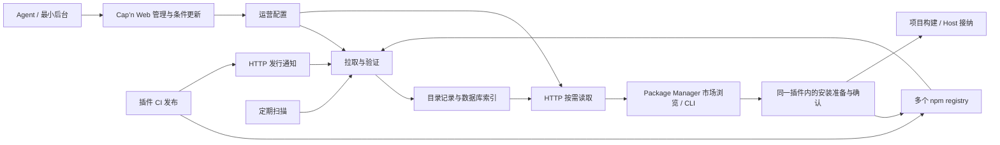

# 插件分发与市场基础提案

状态：初版实施中；长期设计与当前支持范围分别维护。日期：2026-11-05。

目标是让同一份插件 npm 制品既能作为项目依赖消费，也能在长驻 Host 中在线安装；公共、私有及项目专属生态共用发布标准。
新市场协议独立于旧市场 CLI 与旧 schema；消费端在现有 Package Manager 内整合市场和安装流程，保留已经验证的不可变 pnpm 安装边界。
当前实现入口是 [Worker 项目](../../../projects/plugin-market/README.md)与[插件用法](../../../docs/plugins/package-manager.md)。下文尚未落地的完整 provenance、发布 manifest、私有来源和 Host 影响预检仍是提案；[Worker 可行性实验](../../spikes/plugin-market-worker/README.md)保留原生验证限制的证据。

## 当前讨论重心

先确定市场的运行边界、数据所有权、配置更新和目录交付方式。ban、重定向、人工登记是运营配置可能承载的内容，具体 feature 语义后续再定。
安装准入、离线授权与完整生命周期流程也不作为市场底座的前置协议。

已选技术方向为 **Drizzle ORM + SQLite schema，以 Cloudflare Workers 与 D1 为部署目标**。
JSON 用于编辑与 API，数据库负责按记录增量保存与查询。
市场发布者拥有目录与运营决定；一个巨大 `index.json` 不承担全部消费协议。
消费端 Package Manager 可选配置市场 API，读取当前页面和所需详情；未配置时仍可直接安装 npm 包。
插件 CI 发布后主动通知市场，市场从 npm registry 拉取实际制品并复用 npm provenance 校验来源；定期扫描负责补漏与复核。
对外读取与 CI 通知使用标准 HTTP + JSON；后台、CLI 与 Agent 共用 Cap’n Web 管理 API，首版使用 HTTP batch 和最小管理界面。
发布管线由版本工具、标准 build、原生打包和 npm 发布协同完成；各自维护版本计划、生成事实、依赖转换与发行结果。
目录区分 tag 指向、版本校验和来源可用性；安装请求固定精确发行，升级影响按 Host 的实际身份与依赖检查，卸载保留数据。

Worker 的 HTTP 入口负责市场查询、运营管理和发行通知，Cron 处理通知待办及有界扫描；两者通过 Drizzle 访问相同的数据模型，D1 是目标托管数据库。
大对象按需放 R2；Agent 可以编辑 JSON，不要求底层将整个目录或规则集合保存为一个 JSON 文件。
同一市场先使用一个扫描调度所有者。当前聚焦 Cloudflare 路线；市场服务不要求启动完整 Pluxel Host。

## 文档入口

| 问题                              | 权威提案                             | 当前深度                        |
| --------------------------------- | ------------------------------------ | ------------------------------- |
| 状态放哪里、如何编辑、怎样部署    | [底层结构与配置](foundation.md)      | 本轮主要决定                    |
| Agent 与后台如何管理市场          | [管理 API 与最小后台](management.md) | Cap’n Web、条件编辑与回执       |
| CI 通知、多 registry 如何进入目录 | [目录生产](index-production.md)      | npm provenance、拉取与提交      |
| HTTP 如何查询、通知与缓存         | [目录消费](index-protocol.md)        | 状态、回执与数据访问约束        |
| 作者如何构建与发布包              | [发布格式](package-format.md)        | 版本、依赖、manifest 与打包边界 |
| 客户端如何选择市场                | [市场客户端](market-client.md)       | Plugin 与应用配置边界           |
| 两类安装、升级与卸载如何接入      | [安装与生效](installation.md)        | 身份、影响检查与结果所有权      |
| 下一步验证什么                    | [交付与验收](delivery-plan.md)       | 底座优先，后续问题分开          |

各页维护自己的事实，不将存储路径、扫描游标或平台 binding 暴露成插件作者契约。

## 已有基础与范围

当前 [Plugin identity](../../PLUGIN_IDENTITY.md) 使用公开入口与具名导出，版本、摘要和物理路径不参与运行身份。
[Host / Core](../../PLUGIN_SYSTEM.md) 分别拥有装配与运行机制；[生命周期](../../CORE_LIFECYCLE_SEMANTICS.md) 拥有实际接纳与运行结果。
新分发层对接这些边界；现有生成 metadata 的字段名和存储布局不因此成为新发布标准。

Worker 与消费端分别部署；消费端市场浏览与安装作为同一 Plugin 的不同职责演进。
市场收录不替代制品完整性、目标 Host 兼容性或运行检查；首版按管理员信任的插件代码设计。
具体 schema、查询索引、获取引擎和公开 API 名称在代表路径验证后确定。
已验证本地 D1 通知、条件编辑、租约和 HTTP batch；当前 Sigstore 在 workerd 中的原生校验存在可复现兼容问题，实施门槛与下一步见[交付顺序](delivery-plan.md#开始实施的范围)。
