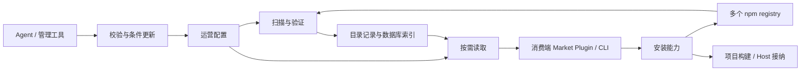

# 插件分发与市场基础提案

状态：设计草案；技术方向已确定，协议细节尚未定稿，未实现。日期：2026-11-04。

目标是让同一份插件 npm 制品既能作为项目依赖消费，也能在长驻 Host 中在线安装；公共、私有及项目专属生态共用发布标准。
本组提案独立于 legacy Package Manager、旧市场 CLI、旧 schema 和旧安装布局。当前交付是设计文档。

## 当前讨论重心

先确定市场的运行边界、数据所有权、配置更新和目录交付方式。ban、重定向、人工登记是运营配置可能承载的内容，具体 feature 语义后续再定。
安装准入、离线授权与完整生命周期流程也不作为市场底座的前置协议。

已选技术方向为 **Drizzle ORM + SQLite，以 Cloudflare Workers 及其生态为部署目标，后续接入 D1**。
JSON 用于编辑与 API，数据库负责按记录增量保存与查询。
市场发布者拥有目录与运营决定；一个巨大 `index.json` 不承担全部消费协议。
消费端 Market Plugin 配置市场 API，读取当前页面和所需详情；获取层按精确来源取包。

Worker 的 HTTP 入口负责市场查询和运营管理，Cron 触发有界扫描；两者通过 Drizzle 访问相同的数据模型，D1 是目标托管数据库。
大对象按需放 R2；Agent 可以编辑 JSON，不要求底层将整个目录或规则集合保存为一个 JSON 文件。
同一市场先使用一个扫描调度所有者。当前聚焦 Cloudflare 路线；市场服务不要求启动完整 Pluxel Host。

## 文档入口

| 问题                           | 权威提案                        | 当前深度                 |
| ------------------------------ | ------------------------------- | ------------------------ |
| 状态放哪里、如何编辑、怎样部署 | [底层结构与配置](foundation.md) | 本轮主要决定             |
| 多 registry 如何变成可发布目录 | [目录生产](index-production.md) | 扫描与发布边界           |
| 如何按需读取和缓存             | [目录消费](index-protocol.md)   | 数据访问约束，未冻结路由 |
| 作者如何发布包                 | [发布格式](package-format.md)   | 字段与 manifest 草案     |
| 客户端如何选择市场             | [市场客户端](market-client.md)  | Plugin 与应用配置边界    |
| 两类安装如何接入               | [安装与生效](installation.md)   | 必须保留的职责           |
| 下一步验证什么                 | [交付与验收](delivery-plan.md)  | 底座优先，后续问题分开   |

各页维护自己的事实，不将存储路径、扫描游标或平台 binding 暴露成插件作者契约。

## 已有基础与范围

当前 [Plugin identity](../../PLUGIN_IDENTITY.md) 使用公开入口与具名导出，版本、摘要和物理路径不参与运行身份。
[Host / Core](../../PLUGIN_SYSTEM.md) 分别拥有装配与运行机制；[生命周期](../../CORE_LIFECYCLE_SEMANTICS.md) 拥有实际接纳与运行结果。
新分发层对接这些边界；现有生成 metadata 的字段名和存储布局不因此成为新发布标准。

市场后台、消费端市场 Plugin、安装能力分别可以独立演进。
市场收录不替代制品完整性、目标 Host 兼容性或运行检查；首版按管理员信任的插件代码设计。
具体 schema、查询索引、获取引擎和公开 API 名称在代表路径验证后确定。
