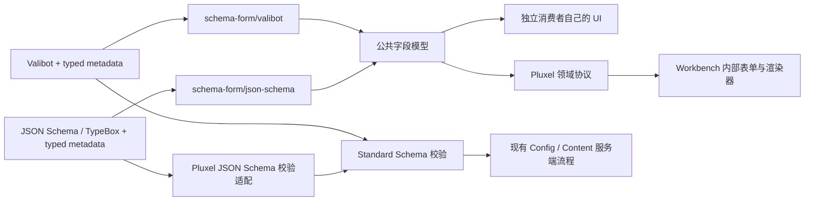

# Schema Form：独立表单契约与 Pluxel UI 迁移

状态：设计提案，尚未实施。核对日期：2026-11-13。

建议将 `valibot-form` 重构为可独立发布的 `@pluxel/schema-form`。包负责带类型的展示元数据、schema 到字段模型的转换，以及可序列化字段模型的读取校验；Pluxel Workbench 拥有 React/Mantine 渲染器和表单交互。Valibot 与 JSON Schema 共用字段语义，TypeBox 通过 JSON Schema 路径接入。

这次应重新审视整个公开面，包括默认值、原始输入、错误路径、渲染提示、包依赖和最短示例。审查范围覆盖完整使用链，实施范围围绕表单包与其现有消费者。Core/Host 的配置持久化、revision 和插件生命周期继续由原有模块维护。

## 交付目标

外部开发者安装这个包后，可以为 Valibot 或 JSON Schema 添加有补全的表单信息，提取字段，并用自己的 UI 渲染。安装和运行这条路径无需 Pluxel Host、React、Mantine 或表单状态库。

Pluxel 作者继续通过 `configs.use()` 声明配置；JSON Schema 经过明确的运行时校验适配进入该接口。Workbench 配置页与 Content 表单消费相同字段模型，保留各自的提交和资源所有者。包迁移同时完成内部 UI 的适配与交互整理。

独立发布是可安装、可理解、可消费的承诺：验收包括离开 monorepo 的真实 tarball 安装、每个子路径的类型解析，以及一个不使用 Mantine 的最小消费者。

## 当前依据

| 已有实现                                                                                                                                                                                                                  | 对设计的影响                                                        |
| ------------------------------------------------------------------------------------------------------------------------------------------------------------------------------------------------------------------------- | ------------------------------------------------------------------- |
| [`configs.use()`](../../../packages/core/src/plugins/composition/PluginConfigs.ts) 使用 `StandardSchemaV1`                                                                                                                | 配置生命周期可以继续使用现有验证接口；普通 JSON Schema 尚需校验适配 |
| [`meta.ts`](../../../packages/valibot-form/src/core/meta.ts) 已有通用及各字段类型的 metadata                                                                                                                              | 复用概念和名称，审查其值域、组合及实际消费情况                      |
| [`fields.ts`](../../../packages/valibot-form/src/core/fields.ts) 将 Valibot 转成 `FieldNode`                                                                                                                              | 把公共模型与 Valibot 遍历分开，再增加 JSON Schema 提取              |
| [`AutoForm`](../../../packages/valibot-form/src/web/components/AutoForm.tsx) 已有 `fields` 模式                                                                                                                           | UI 可以移入 Pluxel，按字段模型工作                                  |
| [服务端 presentation](../../../packages/services/src/management/api/presenters/configPresentation.ts) 与 [Shell adapter](../../../packages/workbench/shell/src/app/workbench/presentationAdapter.ts) 双向转换近似字段模型 | 统一模型后删除重复映射；RPC 的外层版本和领域验证仍由 Services 拥有  |
| [Host 输入绑定](../../../packages/host/src/input-binding-contract.ts)、[环境映射类型](../../../packages/host/src/bindings.ts) 依赖 Valibot shape                                                                          | JSON Schema 支持必须覆盖部署输入，不能只验证表单能显示              |
| [配置表单所有权](../../../packages/workbench/shell/src/app/plugins/config/README.md) 已规定独立 section baseline 与提交快照                                                                                               | UI 重构保持这些行为，布局分组不能改变保存单元                       |
| [Content presentation 测试](../../../packages/workbench/tests/workbench-content-presentation.test.ts) 有独立的发布限制                                                                                                    | 迁移共享模型时保留 action 与 display 的不同接纳规则                 |

当前配置教程以 Valibot 为完整支持路径；这里的目标入口和代码均为提议，不能据此认定 JSON Schema 已能用于配置。

## 推荐边界

| 入口或模块                        | 拥有的内容                                                           |
| --------------------------------- | -------------------------------------------------------------------- |
| `@pluxel/schema-form`             | 公共字段与元数据类型、字段模型校验、与 UI 无关的 section 分组        |
| `@pluxel/schema-form/valibot`     | 原有 `f.*Meta()`、Valibot 字段提取和原始输入投影                     |
| `@pluxel/schema-form/json-schema` | typed annotation helper、JSON Schema 字段提取和原始输入投影          |
| Pluxel 配置集成                   | JSON Schema 数据校验与默认值策略、Standard Schema 接入、部署输入绑定 |
| Pluxel Workbench                  | renderer 映射、Mantine 控件、TanStack Form、草稿、错误呈现和交互     |

根入口与 JSON Schema 入口不加载 Valibot；独立包不依赖其他 `@pluxel/*` 包。Valibot 只由其适配入口加载。TypeBox 作者对象由 JSON Schema 结构接入，表单包无需加载 TypeBox 编译器。具体依赖策略与独立安装验收见 [迁移与验收](migration.md)。

现有 `/web` 的实现进入 Pluxel 内部。作者继续使用 schema 的原生类型、组合和校验规则，包只追加展示信息与可读取投影。runtime registry、React Context、组件名、CSS props 和 RPC capability 都留在消费者侧。

## 与 JSON Render 的关系

[JSON Render](https://github.com/vercel-labs/json-render) 的 catalog、spec 与 renderer registry 覆盖组件树、属性、状态绑定和动作；这项设计与它共享可序列化描述及宿主组件映射的模式。

这里的公共模型围绕配置字段：字段接受什么原始值、有哪些可展示约束、怎样编辑及组织。schema 是结构来源，renderer 解释有限的展示偏好。任意组件树、执行表达式、动作编排和 AI 生成协议均由独立需求决定，不加入本次包契约。如果后续确实需要通用 UI 组合，应另行评估直接采用 JSON Render，而非逐步向字段模型塞入通用 UI 语言。

## 设计文件

- [契约与公开 API](api.md)：字段语义、typed metadata、两个适配入口、JSON Schema 支持范围、失败与 agent 使用体验。
- [Pluxel 集成与 UI](pluxel.md)：配置校验桥、默认值、部署绑定、Content 边界，以及内部表单重组和交互设计。
- [迁移与验收](migration.md)：真实消费者清单、实施顺序、独立发行、agent 使用验收及删除旧入口的条件。

工程依据是 [API 设计规则](../../../.agents/rules/library-api-design.md)、[Config](../../CONFIG.md)、[Frontend](../../FRONTEND.md) 和 [Workbench 交互设计](../../WORKBENCH_DESIGN.md)。完成的规则应回到所属正式文档，本目录只保留尚未实施的设计。

## 实施前需要锁定的窄问题

1. 用当前 TypeBox 版本证明 metadata helper 保留字段、enum、optional 和 readonly 推导；宽类型 JSON 输入需要真实运行时诊断。
2. 验证 JSON Schema 校验桥的默认值、输入/输出类型与错误路径。选定实现必须满足 [集成规则](pluxel.md)，原型失败应修正该适配，不扩大表单包职责。
3. 逐项确认现有 metadata 的真实消费者与 renderer 行为。已承诺且被使用的能力迁移后仍须可用；只存在于类型而未生效的字段须明确处理。

以上是实施前的验证任务，不要求再讨论整体分层。首个完成样例必须跨过 TypeBox 作者声明、Host 校验、Workbench 编辑与保存回读，然后再扩展结构覆盖。
